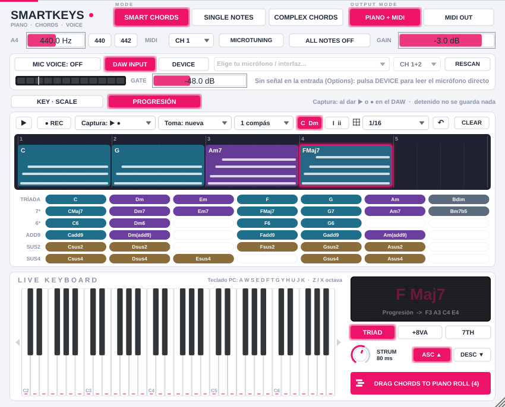

# SmartKeys — Piano inteligente, generador de acordes y controlador vocal (VST3 / AU / Standalone)


SmartKeys (JUCE 8, C++17) se instala en dos versiones que salen del mismo código:

| Plugin | Tipo | Dónde se carga | Para qué |
|---|---|---|---|
| **SmartKeys** | Instrumento (VST3 · AU · app Standalone) | Channel Rack de FL Studio, pista MIDI de Ableton | Tocar acordes con el teclado, el Piano Roll o la voz |
| **SmartKeys FX** | Efecto (VST3 · AU) | La pista del **micrófono** en el Mixer de FL Studio (o una pista de audio) | Convertir la voz de esa pista en acordes sin ningún ruteo |

Las dos hacen lo mismo:

- **Cuantizan** cualquier nota (teclado MIDI, teclado de la PC, Piano Roll o tu voz) a la escala elegida: es imposible tocar una nota fuera de escala.
- **SMART CHORDS**: cada tecla dispara el acorde diatónico completo de ese grado (tríada, tríada + octava o cuatriada con 7ª). En Fa Mayor: Do → C Maj, Re → Dm, Mi → E dim.
- **COMPLEX CHORDS**: cada tecla dispara un acorde de 5 a 7 notas a dos manos (R&B / Neo-Soul), con tres variaciones y velocidades balanceadas por voz.
- **Salida MIDI siempre activa**: cada tecla sale como el **acorde completo** por MIDI (en el canal 1–16 que elijas) hacia cualquier otro plugin. `PIANO + MIDI` además lo toca con el piano interno; `MIDI OUT` silencia el piano.
- **STRUM**: las notas del acorde entran escalonadas, de grave a aguda (`ASC ▲`) o al revés (`DESC ▼`), con una perilla de 0 a 250 ms.
- **PROGRESIÓN** (estilo Klimper): un carril por compases donde se guardan los acordes que grabas con el DAW o que armas con la **paleta de acordes** de la escala (cifrado o grados romanos).
- **DRAG CHORDS TO PIANO ROLL**: arrastras la progresión como `.mid` al Piano Roll, con todas las notas de cada acorde apiladas en su compás exacto.
- **Voz → acordes en tiempo real**: lee el micrófono por la entrada del DAW **o directamente de tu interfaz de audio** (botón `DEVICE`). La voz cruda nunca sale por el plugin.
- **43 escalas**: básicas, 21 occidentales, 7 maqam árabes y 12 ragas indias (Hindustani y Carnatic).

---

## Novedades de la versión 1.2.0

| En 1.1.0 | En 1.2.0 |
|---|---|
| En `PIANO` no salía MIDI, así que el plugin conectado no recibía el acorde | La **salida MIDI de los acordes completos está siempre activa**. `OUTPUT MODE` sólo decide si además suena el piano interno: `PIANO + MIDI` (por defecto) o `MIDI OUT` |
| `DRAG CHORDS` acumulaba todo lo que tocabas, incluso probando sonidos con el DAW detenido (por ejemplo, "84" acordes) | **Sólo se graba** cuando el DAW reproduce o graba, o con el botón **● REC** del plugin. Con el DAW detenido, probar teclas no guarda nada |
| Los acordes se exportaban empezando en el compás 1, sin relación con el proyecto | Cada acorde se guarda en su **posición exacta del compás** (`ppqPosition`) y con la **duración de la nota original**: al soltar el `.mid` en el Piano Roll, los acordes completos quedan donde estaban las notas sueltas |
| No había forma de armar una progresión a mano | **Pestaña PROGRESIÓN** estilo Klimper: carril por compases, paleta de acordes de la escala (tríadas, 7ª, 6ª, add9, sus2, sus4), cifrado `C Dm Em` o grados `I ii iii`, vista previa ▶ en bucle, deshacer |
| `QUANTIZE 1/16` fijo | Desplegable: `none`, `1/32`, `1/16`, `1/8`, `1/4`, `1/8 triplets`, `1/16 triplets` |
| Los acordes entraban siempre en bloque | Perilla **STRUM** (0–250 ms) + `ASC ▲ / DESC ▼`. El teclado se ilumina nota a nota y el `.mid` lleva el mismo desfase |
| Ventana de tamaño fijo | Ventana **redimensionable**, con la proporción fija; el tamaño se guarda con el proyecto |

La 1.1.0 trajo la limpieza automática de versiones anteriores al instalar, el micrófono directo (`DEVICE`), SmartKeys FX, el selector de canal MIDI y el primer `DRAG CHORDS`.

---

## Descargar los instaladores (sin compilar nada)

GitHub compila y prueba SmartKeys en cada cambio y publica los instaladores en la página **Releases** de este repositorio (**SmartKeys 1.2.0**):

- **Mac:** `SmartKeys-1.2.0-macOS.pkg`. Funciona en Mac con chip Apple e Intel. Instala SmartKeys (VST3, AU y app) y SmartKeys FX (VST3 y AU).
- **Windows:** `SmartKeys-1.2.0-Windows-Setup.exe`. Instala SmartKeys (VST3 y app) y SmartKeys FX (VST3).

**Los dos instaladores eliminan automáticamente la versión anterior** antes de copiar la nueva. No hace falta borrar nada a mano. El registro de lo que se borró en Mac queda en `/tmp/smartkeys-install.log`.

En Mac, el `.pkg` no está firmado con un certificado de Apple. La primera vez, macOS dirá que no puede verificar al desarrollador. Para abrirlo, ve a **Ajustes del Sistema → Privacidad y seguridad → "Abrir igualmente"** y vuelve a abrir el `.pkg`. Después, en FL Studio: **Options → Manage plugins → Find installed plugins**.

---

## Instalar desde el código con un solo comando

### macOS: borra la versión vieja, compila e instala

```bash
bash Installer/install_mac.sh
```

1. Comprueba las Command Line Tools de Apple y CMake (si falta CMake, lo instala con Homebrew o solo para tu usuario).
2. Borra SmartKeys y SmartKeys FX (`.vst3`, `.component`, `.app`) de `/Library`, de `~/Library` de cada usuario y de `/Applications`. También borra la caché de Audio Units y la ficha de FL Studio.
3. Compila el binario Universal y genera `Installer/Output/SmartKeys-1.2.0-macOS.pkg`.
4. Instala el `.pkg` y reinicia `AudioComponentRegistrar` para que FL Studio y Ableton vean el binario nuevo.

Te pide la contraseña de administrador en los pasos 2 y 4. Para desinstalar todo: `bash Installer/uninstall_mac.sh`.

### Windows

```bat
Installer\build_windows.bat
```

Compila, genera `SmartKeys-1.2.0-Windows-Setup.exe` y lo ejecuta. El instalador borra antes la versión anterior. Requisitos: Visual Studio 2022 con "Desarrollo para escritorio con C++", CMake 3.22+, Git e [Inno Setup 6.3+](https://jrsoftware.org/isdl.php). Añade `noinstall` para solo generar el `.exe`.

### Para desarrolladores: copiar al compilar

```bash
cmake -B build -DCMAKE_BUILD_TYPE=Release -DSMARTKEYS_COPY_AFTER_BUILD=ON
cmake --build build --config Release
```

Con `SMARTKEYS_COPY_AFTER_BUILD=ON`, cada compilación hace tres cosas:

- **Antes de copiar** (PRE_BUILD) borra el `.vst3` y el `.component` anteriores de las carpetas de plugins de tu usuario.
- Copia los nuevos (`COPY_PLUGIN_AFTER_BUILD`).
- En Mac, al terminar (POST_BUILD), reinicia `AudioComponentRegistrar`.

Está desactivado por defecto para no dejar una segunda copia en `~/Library` junto a la que instala el `.pkg` en `/Library` (dos copias son justo lo que hace que el DAW cargue una versión vieja). JUCE 8.0.15 se descarga automáticamente; con `-DJUCE_DIR=/ruta/a/JUCE` se usa una copia local.

---

## Uso en el DAW

### Tocar
Carga **SmartKeys** como instrumento: en FL Studio va en el Channel Rack y en Ableton en una pista MIDI. Elige **KEY** y **SCALE** en la pestaña `KEY · SCALE` y toca. Con un clic en las notas de la barra **ESCALA** puedes activarlas o desactivarlas. El teclado de abajo ilumina las notas que suenan y el display muestra el acorde (`Dm`, `Gm7`, `F Maj9`…).

### OUTPUT MODE y canal MIDI
La salida MIDI de los acordes completos está **siempre activa**: cada tecla sale como el acorde entero (3, 4 o 5–7 notas) con el mismo instante y duración.

| Botón | Piano interno | MIDI OUT |
|---|---|---|
| `PIANO + MIDI` (por defecto) | suena | sale el acorde completo |
| `MIDI OUT` | en silencio | sale el acorde completo |

`MIDI CH 1–16` elige el canal MIDI de salida. Si cambias el canal con una tecla pulsada, sus NoteOff salen por el canal original, así que no quedan notas colgadas. El **puerto** MIDI lo asigna el DAW:

- **FL Studio:** en SmartKeys, abre el engranaje ⚙ (*Fruity Wrapper*) → MIDI → **Output port** = 1. En el plugin destino, **Input port** = 1.
- **Ableton Live:** crea otra pista MIDI con *MIDI From* = `SmartKeys` y pon en ella el instrumento destino.

### STRUM (entrada progresiva de las notas)
La perilla **STRUM** (junto al display) va de `OFF` a 250 ms:

- En `OFF` todas las notas del acorde entran a la vez.
- Al subirla, la nota *i* entra con un retardo `i · base · (1 + 0.15·i)`. Cada nota tarda un poco más que la anterior, como un pianista que desgrana el acorde.
- `ASC ▲` entra de la más grave a la más aguda (F4 → A4 → C5); `DESC ▼`, al revés (C5 → A4 → F4).
- Si sueltas la tecla antes de que entren todas, las que faltaban se cancelan y las que sonaban se apagan juntas: nunca quedan notas colgadas.
- Funciona en el piano interno, en la salida MIDI, con la voz, en la vista previa y en el `.mid` exportado. Doble clic en la perilla: `OFF`.

### Convertir las notas sueltas del Piano Roll en acordes completos
FL Studio no deja que un plugin reescriba las notas de su propio Piano Roll: lo que sí puede hacer SmartKeys es **grabar** los acordes que genera y devolvértelos como `.mid`.

1. Ten tus notas sueltas en el Piano Roll de SmartKeys (por ejemplo `F4, C5, B4, A4`).
2. Dale **PLAY** (▶) en FL Studio. Mientras suena, SmartKeys guarda cada acorde completo en la pestaña **PROGRESIÓN**, en su compás y con su duración. La fila de pestañas muestra `● GRABANDO DESDE EL DAW · compás N`.
3. Detén FL Studio y **arrastra el botón `DRAG CHORDS TO PIANO ROLL (n)`** encima del Piano Roll de otro instrumento (por ejemplo FL Keys): aparecen los acordes completos (`F4 + A4 + C5`, `C5 + E5 + G5`…) en los mismos tiempos.
   - Si lo sueltas en el Piano Roll del propio SmartKeys (en lugar de las notas sueltas), cambia SmartKeys a `SINGLE NOTES`. Así no vuelve a convertir cada nota del acorde en otro acorde.
4. Si el patrón está en bucle, cada vuelta reemplaza a la anterior: nunca se duplican acordes.

### Cuándo se graba (pestaña PROGRESIÓN)
- **Captura** `▶ ●` (por defecto): al reproducir o grabar el DAW. `●`: sólo cuando el DAW graba. `REC`: sólo con el botón del plugin.
- **● REC**: graba aunque el DAW esté detenido, al tempo del proyecto (la toma se alinea al compás 1 o al compás siguiente a lo que ya hay).
- Con el DAW detenido y REC apagado, **probar teclas no guarda nada**.
- **Toma** `nueva` (por defecto): la toma nueva reemplaza la progresión **al tocar su primer acorde**. Si das PLAY sin tocar nada, no se borra nada, y con `↶` puedes deshacer.
- **Toma** `añadir`: conserva lo anterior. Desde el primer acorde que toques hasta que detengas el DAW, sólo se reemplaza el tramo por el que pasa el cursor, como un punch-in. Con `● REC` y el DAW detenido, la toma se añade al final.

### Armar una progresión a mano (estilo Klimper)



- **Paleta**: una columna por cada nota de la escala activa y una fila por tipo (`TRÍADA`, `7ª`, `6ª`, `ADD9`, `SUS2`, `SUS4`). Sólo aparecen acordes con notas de la escala; las casillas sin acorde diatónico quedan vacías.
- **Clic** en un acorde: lo escuchas y se añade al final con la duración elegida (`1 tiempo`, `2 tiempos`, `1 compás`, `2 compases`). **Arrástralo** al carril para insertarlo donde quieras.
- `C  Dm` / `I  ii` cambia entre cifrado y grados romanos (`I ii iii IV V vi vii°`, `IΔ7 ii7 V7 viiø7`, en menor `i ii° III iv v VI VII`).
- En el **carril**:
  - Arrastra un acorde para moverlo; arrastra su borde derecho para alargarlo.
  - `Supr` lo borra, `Cmd/Ctrl+D` lo duplica y `Cmd/Ctrl+Z` deshace. El clic derecho tiene las mismas opciones.
  - Cada bloque muestra sus notas apiladas y el desfase del STRUM.
- **▶** reproduce la progresión en bucle al tempo del proyecto, por el piano interno y la salida MIDI. Se detiene sola si das PLAY en el DAW.
- **QUANTIZE**: `none`, `1/32`, `1/16`, `1/8`, `1/4`, `1/8 triplets`, `1/16 triplets`. Ajusta el inicio y el final de cada acorde al exportar y sirve de rejilla al mover. El desfase del STRUM se conserva.

La progresión se guarda con el proyecto del DAW.

### Controlador vocal: tres formas de meter la voz

Activa **`MIC VOICE: ON`** y ajusta **GATE** (por defecto −48 dB). El medidor se ilumina cuando cantas por encima del umbral, y la etiqueta muestra en vivo lo que detecta: `Mic: A3 -> Am`. Con el DAW en PLAY o con REC, los acordes cantados también se graban en la progresión.

**A. `DEVICE`: el micrófono directo (recomendado; sirve en cualquier DAW)**
1. Pulsa `DEVICE` y elige tu interfaz o micrófono en la lista (por ejemplo `Volt 1`), y el canal: `CH 1`, `CH 2` o `CH 1+2`.
2. SmartKeys abre esa entrada **solo para leerla**: no toca la salida de audio del DAW, y FL Studio puede seguir usando la misma interfaz.
3. En Mac, el permiso del micrófono es de la aplicación anfitriona. Si la etiqueta dice *"Sin señal: permite el micrófono a tu DAW"*, activa FL Studio (o Ableton) en **Ajustes del Sistema → Privacidad y seguridad → Micrófono** y reinicia el DAW.
4. `RESCAN` vuelve a buscar dispositivos (por ejemplo, si conectas la interfaz con el DAW abierto).

**B. SmartKeys FX en la pista del micrófono (FL Studio)**
1. En el Mixer, selecciona la pista donde entra tu micrófono (*Input* = tu interfaz) y carga **SmartKeys FX** en un slot de efectos.
2. `DAW INPUT` + `MIC VOICE: ON`. Lo que cantas en esa pista se convierte en acordes.
   - Con `PIANO + MIDI`, la pista suena con el piano de SmartKeys en lugar de tu voz.
   - Los acordes salen además por MIDI hacia otro plugin mediante el *Output port* del wrapper.

**C. Sidechain (instrumento SmartKeys)**
- **Ableton Live 11/12:** en el dispositivo SmartKeys abre el panel **Sidechain**, actívalo y elige la pista del micrófono en *Audio From*.
- **Standalone:** usa la entrada elegida en *Options → Audio/MIDI Settings*, o `DEVICE`.

---

## Controles

| Control | Función |
|---|---|
| `SMART CHORDS / SINGLE NOTES / COMPLEX CHORDS` | Acorde diatónico (3–4 notas), nota individual cuantizada, o acorde a dos manos (5–7 notas) |
| `PIANO + MIDI / MIDI OUT` | OUTPUT MODE: el MIDI sale siempre; elige si suena el piano interno |
| `MIDI CH 1…16` | Canal MIDI de salida |
| `A4` + `440 / 442` | Afinación del piano interno (400–480 Hz) |
| `MICROTUNING` | Afina el piano interno con los cents reales de la escala (maqam, justa, pitagórica, shrutis) |
| `ALL NOTES OFF` | Pánico: suelta todas las notas (y cancela las pendientes del STRUM) |
| `GAIN` | Volumen del piano (−60 a +6 dB) |
| `MIC VOICE` · `DAW INPUT / DEVICE` | Activa la voz y elige de dónde llega |
| Lista de dispositivos · `CH 1 / CH 2 / CH 1+2` · `RESCAN` | Micrófono directo (vía DEVICE) |
| Medidor · `GATE` · etiqueta `Mic:` | Nivel de entrada, umbral del gate y nota/acorde detectados en vivo |
| Pestaña `KEY · SCALE` | Tónica, escala (`Más escalas`: Occidentales / Árabes / Indias) y notas activas una a una |
| Pestaña `PROGRESIÓN` | `▶` vista previa · `● REC` · `Captura` · `Toma` · duración · `C Dm / I ii` · QUANTIZE · `↶` · `CLEAR` · carril · paleta |
| `TRIAD / +8VA / 7TH` | Grados k, k+2, k+4 · + octava · + séptima (en SMART CHORDS) |
| `LUSH 7/9 / NEO-SOUL / CINEMATIC` | Variación de COMPLEX CHORDS (aparece en ese modo) |
| `STRUM` · `ASC ▲ / DESC ▼` | Entrada progresiva de las notas del acorde (0–250 ms) y su dirección |
| `DRAG CHORDS TO PIANO ROLL` | Arrastra la progresión al Piano Roll; clic: guarda el `.mid` en `Música/SmartKeys` |
| Teclado PC | `A W S E D F T G Y H U J K` = una octava, `Z / X` = bajar/subir octava |

---

## Modo COMPLEX CHORDS


La tecla (MIDI, teclado de la PC, Piano Roll o voz) se cuantiza a la escala (`d0`, índice `k`) y genera:

| Voz | 7th & 9th Lush | 9th & 11th Neo-Soul | Cinematic Spread Add9 | Velocidad |
|---|---|---|---|---|
| Mano izquierda | `d0 − 12`, `(k+4) − 12` | `d0 − 12`, `(k+4) − 12` | `d0 − 12`, `(k+4) − 12` | 95 % |
| Mano derecha | `k`, `k+2`, `k+6`, `k+8` | `k`, `k+2`, `k+6`, `k+8` | `k`, `k+8` (add9), `k+9` (10ª) | 80 % |
| Voz superior | `k+11` (5ª arriba) | `k+10` (11ª) | `k+11` (12ª), `k+14` (raíz +2 octavas) | 90 % (la más aguda) |

Progresión de **Fa Mayor** (I–vii, tecla en la 4ª octava, 7 notas por acorde):

| Variación | I | ii | iii | IV | V | vi | vii |
|---|---|---|---|---|---|---|---|
| Lush | F Maj9 | Gm9 | Am7(11) | Bb Maj9 | C9 | Dm9 | Em7b5 |
| Neo-Soul | F Maj13 | Gm11 | Am7(11) | Bb Maj9#11 | C13 | Dm11 | Em7b5(11) |
| Cinematic | Fadd9 | Gm(add9) | Am(add11) | Bbadd9 | Cadd9 | Dm(add9) | E dim |

**Regla anti-choques (avoid notes).** Si una extensión cae a 1 semitono (2ª menor) o a 13 semitonos (9ª menor) de otra voz, se sustituye por el siguiente candidato **diatónico**:
- 11ª natural sobre 3ª mayor → 13ª. Por eso sale F Maj13 y no "F Maj11".
- b9 → 11ª u octava.
- En Cinematic sobre acordes menores, la 9ª se sube una octava.

Las notas siempre pertenecen a la escala activa (verificado en 198 144 voicings).

**Velocity voicing:**
- Mano izquierda: 95 %.
- Voces centrales: 80 %.
- Voz superior: 90 %.

**Polifonía:** 32 voces, que dan para 4 acordes de 7 notas sostenidos.

**MIDI:** el buffer de salida se reemplaza (`swapWith`) por el acorde completo. `ActiveNoteRegistry` guarda las 7 notas para soltarlas todas con el NoteOff, aunque cambies de modo, de escala o de canal con la tecla pulsada.

---

## Decisiones técnicas

**Orden estricto del `processBlock`.**
1. Lee el transporte del DAW (tempo, compás, PLAY/REC, `ppqPosition`) y decide si este tramo se graba.
2. Lee el micrófono (bus de entrada del DAW o FIFO del dispositivo) y ejecuta el detector de voz.
3. Publica el nivel y la nota detectada para el medidor y la etiqueta `Mic:`.
4. `buffer.clear()`: la voz cruda nunca sale.
5. Expande cada nota de entrada (MIDI, Piano Roll, teclado en pantalla, voz, paleta y vista previa) al acorde completo, en orden de muestra, y lo captura si toca.
6. STRUM: reparte las notas de cada acorde en el tiempo con una cola por muestra.
7. Renderiza el piano interno (en `PIANO + MIDI`).
8. `midiMessages.swapWith (...)`: la salida MIDI son siempre los acordes completos, con su STRUM.

**Tiempo real.** `processBlock` no asigna memoria ni bloquea:
- Arrays fijos y `MidiBuffer` con capacidad reservada.
- FIFOs lock-free (`AbstractFifo`) para el teclado en pantalla, la paleta, el micrófono directo y la captura.
- La vista previa lee una instantánea de la progresión con un candado sin espera (`SpinLock::tryLock`); si está ocupado, la toma en el bloque siguiente.
- Atómicos para la interfaz.

Las pruebas cuentan cada `new` durante miles de bloques (detector, router, STRUM, captura, motor y sintetizador): **0 asignaciones**.

**Captura inteligente.**
- Cada acorde lleva un identificador. Al pulsar se guarda **completo**: todas sus notas, aunque compartan alguna con el acorde anterior. Al soltar se guarda su final.
- La posición viene del `ppqPosition` del DAW, y el tempo y el compás del proyecto.
- Al detectar un salto atrás del cursor (bucle del patrón), empieza una "vuelta" nueva que sobrescribe lo que se repite.
- Las notas de un STRUM que no llegaron a sonar porque se soltó antes no se guardan.

**Micrófono directo (DEVICE).**
- `HardwareMicInput` abre el dispositivo **solo como entrada**. En Mac, CoreAudio permite que el DAW y SmartKeys lean la misma interfaz a la vez. En Windows depende del driver: si el DAW usa ASIO en modo exclusivo, la entrada puede no estar disponible, y entonces conviene usar SmartKeys FX.
- El callback del dispositivo mezcla a mono y escribe en un FIFO lock-free, que el hilo de audio vacía en cada bloque.
- Si el FIFO acumula más de ~60 ms o 2,5 bloques, se descarta lo más antiguo, así que la latencia nunca crece.
- Solo se abre un dispositivo elegido por el usuario o guardado en el proyecto: los validadores automáticos nunca abren hardware.

**Dos variantes.** El documento pedía `VST3_CATEGORIES "Instrument" "Fx" "Generator"`. JUCE ordena la categoría `Fx` en primer lugar, así que el instrumento se anunciaría como `Fx|Instrument|Generator` y FL Studio lo listaría como efecto, sin poder cargarlo en el Channel Rack. Por eso hay dos plugins:

| Plugin | Categorías VST3 | Tipo AU | Entrada |
|---|---|---|---|
| `SmartKeys` | `Instrument\|Synth\|Generator` | `aumu` | sidechain |
| `SmartKeys FX` | `Fx\|Generator` | `aumf` | principal |

**Limpieza en los instaladores.**
- **macOS:** cada componente del `.pkg` (VST3, AU, App) lleva un `preinstall` que borra solo su tipo de archivo, así ninguno puede borrar lo que otro acaba de instalar. AU también refresca la caché antes y después. Solo se tocan `SmartKeys.*` y `SmartKeys FX.*`; el resto de plugins no se toca.
- **Windows:** `[InstallDelete]` hace lo mismo.

**Detector de voz.**
- Señal decimada a ~24 kHz, YIN sobre 1024 muestras con salto de ~5 ms.
- Histéresis de 35 cents y 3 frames de estabilidad.
- Precisión < 2,1 cents de 65 Hz a 1046 Hz.
- Latencia de disparo: ~30–45 ms.

**Interpretación de escalas ambiguas.**
- *Blues* = blues mayor.
- *Minor Pentatonic + Blues* = pentatónica menor + b5.
- *Melodic Minor (Asc+Dec)* = unión de ambas formas.
- *Bebop* = bebop dominante.
- *Maqam*: el cuarto de tono se cuantiza a la nota natural y lleva −50 cents para `MICROTUNING`.
- *Raga Carnatic* usa la afinación de shrutis.

El MIDI es 12-TET: los cents solo afectan al piano interno.

---

## Estructura

```
SmartKeys/
├── CMakeLists.txt                 SmartKeys (instrumento) + SmartKeys FX (efecto), limpieza al copiar
├── Source/
│   ├── ScaleChordEngine.h         Escalas, cuantización, acordes Smart y Complex, cifrado y grados romanos
│   ├── VoicePitchTracker.h        Gate RMS + YIN + histéresis 35 cents + estabilidad 3 frames
│   ├── HardwareMicInput.h         Micrófono directo (vía DEVICE): dispositivo solo-entrada + FIFO lock-free
│   ├── StrumScheduler.h           STRUM: cola de NoteOn por muestra, ASC/DESC, cancelación al soltar
│   ├── Progression.h              Captura inteligente, carril de progresión, paleta, exportación .mid
│   ├── FlKeysPianoSynth.h         Piano aditivo de 32 voces
│   ├── MidiOutputRouter.h         Expansión a acordes, ids de acorde, paleta/vista previa, ActiveNoteRegistry
│   ├── PluginProcessor.h/.cpp     Parámetros, buses, transporte del DAW, processBlock lock-free
│   ├── PluginEditor.h/.cpp        Interfaz 850×686 vectorial y redimensionable, pestañas
│   ├── ProgressionView.h/.cpp     Paleta de acordes y carril de progresión (estilo Klimper)
│   └── UiCommon.h                 Colores, tipografía y LookAndFeel compartidos
├── Tests/
│   ├── EngineTests.cpp            Comprobaciones del núcleo DSP (558)
│   └── HostTests.cpp              Carga los VST3 compilados como un DAW (con transporte) y comprueba su salida
└── Installer/
    ├── install_mac.sh             Borra la versión vieja + compila + instala (macOS)
    ├── uninstall_mac.sh           Desinstalación completa (macOS)
    ├── build_mac_installer.sh     Compila Universal + pkgbuild/productbuild → .pkg
    ├── macos/                     Scripts preinstall/postinstall de limpieza del .pkg
    ├── Installer_Windows.iss      Inno Setup → .exe ([InstallDelete] de la versión anterior)
    └── build_windows.bat          Compila + genera el .exe + instala
```

---

## Verificación realizada

- **pluginval nivel 10** (el máximo) sobre los dos VST3, con pruebas de editor: **SUCCESS**. Incluye el validador oficial de Steinberg, estado, automatización, seguridad de hilos, fuzzing y buses.
- **558 comprobaciones del núcleo:**
  - Escalas, acordes, voicings complejos y router MIDI.
  - Ids de acorde y detector de voz.
  - STRUM exacto a la muestra (ASC/DESC, NoteOff anticipado, pánico).
  - Captura (tomas, bucles, deshacer, REC con reloj propio) y exportación con QUANTIZE y STRUM.
  - Paleta y grados romanos (mayor, menor y pentatónica).
  - FIFO del micrófono y 0 asignaciones en el audio.
- **Prueba de integración** (`HostTests.cpp`, 35 comprobaciones): carga los VST3 compilados como un DAW, con un transporte simulado, y comprueba:
  - Que cada tecla sale como acorde completo por MIDI en `PIANO + MIDI` y en `MIDI OUT` (este último con silencio absoluto).
  - El STRUM a 100 ms: +5520 y +12480 muestras a 48 kHz, en ASC y en DESC.
  - Que con el DAW detenido no se graba nada.
  - Que con el DAW en PLAY las notas sueltas `F4, C5, B4, A4` se guardan como `F Maj, C Maj, B dim, A min` en los tiempos 1–4, con su duración.
  - Que en bucle sólo queda la última vuelta.
  - La voz → acordes y SmartKeys FX.
- **Limpieza de versiones anteriores** simulada con instalaciones falsas: borra SmartKeys y SmartKeys FX de todas las rutas y deja intactos los demás plugins.
- **En GitHub Actions**, en cada compilación se instala una "versión anterior" falsa en un Mac y en un PC de pruebas, se ejecuta el instalador nuevo y se comprueba que la borró. Después se validan los plugins instalados con `auval` (Apple) y `pluginval` nivel 10.
