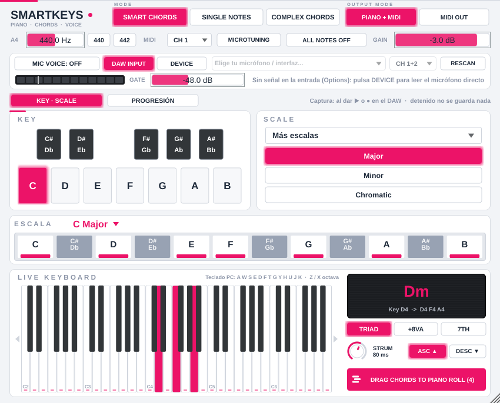
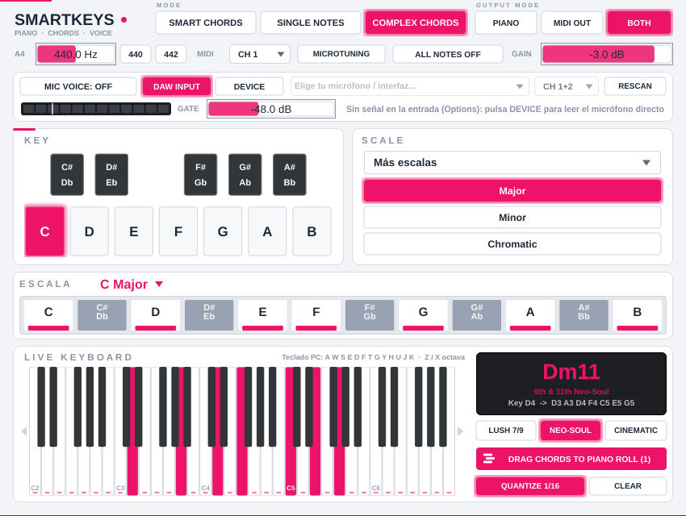

# SmartKeys — Piano inteligente, generador de acordes y controlador vocal (VST3 / AU / Standalone)



SmartKeys es un instrumento (JUCE 8, C++17) que:

- **Cuantiza** cualquier nota que toques (teclado MIDI, teclado de la PC, Piano Roll o tu voz) a la escala elegida: es imposible tocar una nota fuera de escala.
- En **SMART CHORDS**, cada tecla dispara el **acorde diatónico completo** de ese grado (tríada, tríada + octava o cuatriada con 7ª). En Fa Mayor: Do → C Maj, Re → Dm, Mi → E dim.
- En **COMPLEX CHORDS**, cada tecla dispara un **acorde de 5 a 7 notas a dos manos** (estilo R&B / Urbano melódico / Neo-Soul): mano izquierda con raíz y 5ª graves, mano derecha en open voicing con 3ª, 7ª, 9ª y 11ª. Hay tres variaciones, y las velocidades se balancean por voz.
- Emite esas notas por **MIDI OUT** hacia el DAW y las toca con su **piano interno** (síntesis aditiva en código: no hay samples, el binario pesa poco).
- Convierte tu **voz en tiempo real** (tararear o cantar) en notas o acordes, como un vocoder conectado por sidechain. La voz cruda **nunca** sale por el plugin.
- Incluye **43 escalas**: básicas, 21 occidentales, 7 maqam árabes y 12 ragas indias (Hindustani y Carnatic).

---

## Descargar los instaladores (sin compilar nada)

GitHub compila SmartKeys automáticamente en cada cambio y publica los instaladores en la página **Releases** de este repositorio (**SmartKeys 1.0.0**):

- **Mac:** `SmartKeys-1.0.0-macOS.pkg`. Funciona en Mac con chip Apple e Intel e instala VST3, AU y la app Standalone.
- **Windows:** `SmartKeys-1.0.0-Windows-Setup.exe`. Instala el VST3 y la app Standalone.

En Mac, el `.pkg` no está firmado con un certificado de Apple. La primera vez que lo abras, macOS dirá que no puede verificar al desarrollador. Para abrirlo: **Ajustes del Sistema → Privacidad y seguridad → "Abrir igualmente"** y después vuelve a abrir el `.pkg`. Luego, en FL Studio: **Options → Manage plugins → Find installed plugins**.

---

## Estructura

```
SmartKeys/
├── CMakeLists.txt                 VST3 + AU + Standalone, IS_SYNTH, MIDI in/out, mic
├── Source/
│   ├── ScaleChordEngine.h         Escalas, cuantización, acordes Smart y Complex, cifrado de acordes
│   ├── VoicePitchTracker.h        Gate RMS + YIN + histéresis 35 cents + estabilidad 3 frames
│   ├── FlKeysPianoSynth.h         Piano aditivo de 32 voces, martillo, filtro por velocidad
│   ├── MidiOutputRouter.h         Router MIDI, velocidades por voz, ActiveNoteRegistry (anti-notas colgadas)
│   ├── PluginProcessor.h/.cpp     Parámetros, buses, processBlock lock-free
│   └── PluginEditor.h/.cpp        Interfaz 850×560 vectorial
├── Tests/EngineTests.cpp          507 comprobaciones del núcleo DSP
└── Installer/
    ├── Installer_Windows.iss      Inno Setup → .exe (VST3 en {commoncf64}\VST3)
    ├── build_windows.bat          Compila + genera el .exe en un paso
    └── build_mac_installer.sh     Compila Universal + pkgbuild/productbuild → .pkg
```

---

## Compilar e instalar

JUCE se descarga automáticamente (8.0.4). Para usar una copia local: `-DJUCE_DIR=/ruta/a/JUCE`.

### Windows (genera `SmartKeys-1.0.0-Windows-Setup.exe`)
Requisitos: Visual Studio 2022 con "Desarrollo para escritorio con C++", CMake 3.22+, Git e [Inno Setup 6.3+](https://jrsoftware.org/isdl.php).

```bat
Installer\build_windows.bat
```
El instalador copia el VST3 en `C:\Program Files\Common Files\VST3\` y, opcionalmente, la app Standalone.

### macOS (genera `SmartKeys-1.0.0-macOS.pkg`)
Requisitos: Xcode + Command Line Tools, CMake 3.22+.

```bash
chmod +x Installer/build_mac_installer.sh
./Installer/build_mac_installer.sh
```
El `.pkg` instala el VST3 en `/Library/Audio/Plug-Ins/VST3/`, el AU en `/Library/Audio/Plug-Ins/Components/` y la app en `/Applications` (cada parte se puede desmarcar). Compila binario Universal (Apple Silicon + Intel).

Sin certificado de Apple los binarios se firman *ad-hoc*: en tu propia Mac funciona; si macOS bloquea el `.pkg`, haz clic derecho → Abrir. Para distribuirlo a otros, exporta `DEV_ID_APP`, `DEV_ID_INSTALLER` y `NOTARY_PROFILE` (instrucciones dentro del script).

### Solo compilar / pruebas
```bash
cmake -B build -DCMAKE_BUILD_TYPE=Release && cmake --build build --config Release
cmake -B build-tests -DSMARTKEYS_BUILD_TESTS=ON && cmake --build build-tests --target SmartKeysTests
```

---

## Uso en el DAW

### Tocar
Carga SmartKeys como **instrumento** (Channel Rack en FL Studio, pista MIDI en Ableton). Elige **KEY** y **SCALE**, y toca. La barra **ESCALA** permite activar/desactivar notas sueltas con clic. El piano de abajo ilumina en magenta todas las notas que suenan, y el display muestra el acorde (`Dm`, `Gm7`...).

### Grabar los acordes completos en el Piano Roll
SmartKeys **emite** las 3–4 notas de cada acorde por su salida MIDI. Ojo: tanto FL Studio como Ableton graban en la pista del plugin **lo que tú tocas** (la tecla disparadora), no lo que el plugin emite. Para que se dibujen los acordes completos hay que capturar la salida MIDI del plugin:

**Ableton Live**
1. Pista MIDI 1: SmartKeys.
2. Crea la pista MIDI 2 → *MIDI From*: `1-SmartKeys` y debajo `SmartKeys` (post-FX). Monitor: *In* (o *Auto*).
3. Arma la grabación en la pista 2 y toca/tararea en la pista 1 → la pista 2 graba los acordes completos.
   (Pon un instrumento en la pista 2 o deja sonando el piano interno de la pista 1.)

**FL Studio**
1. En el wrapper de SmartKeys (engranaje ⚙ → *VST wrapper settings*), asigna un número en **MIDI Output port** (ej. 1).
2. Carga el instrumento destino (otro canal) y, en su wrapper, pon el **mismo número** en **MIDI Input port**.
3. Graba con el canal destino seleccionado: FL registra en su Piano Roll las notas que le llegan desde SmartKeys.
   Si quieres solo el sonido del destino, apaga `INTERNAL PIANO` en SmartKeys.

Comprueba el comportamiento exacto en tu versión del DAW: el ruteo de MIDI entre plugins varía entre versiones.

### Controlador vocal (micrófono por sidechain)
SmartKeys declara una entrada auxiliar (sidechain) igual que un vocoder:

- **Ableton Live 11/12:** en el dispositivo SmartKeys abre el panel **Sidechain**, actívalo y elige la pista del micrófono (*Audio From*). Esa pista debe tener monitorización activa o estar ruteada.
- **FL Studio:** en el Mixer selecciona la pista del micrófono y usa *Sidechain to this track* hacia la pista del mixer de SmartKeys; en el wrapper de SmartKeys elige esa entrada lateral (la opción exacta depende de tu versión de FL).
- **Standalone:** usa directamente la entrada de audio elegida en *Options → Audio/MIDI Settings* (SmartKeys desactiva el silencio de entrada de la app porque nunca deja pasar la voz a la salida).

Activa `MIC VOICE CONTROLLER: ON` y ajusta **GATE** (por defecto −40 dB) hasta que el LED se ponga magenta solo cuando cantas. Si no armas la pista del micrófono, el DAW graba solo el MIDI; si la armas, grabas también tu toma vocal.

---

## Controles

| Control | Función |
|---|---|
| `SMART CHORDS / SINGLE NOTES / COMPLEX CHORDS` | Acorde diatónico (3–4 notas), nota individual cuantizada, o acorde a dos manos (5–7 notas) |
| `LUSH 7/9 / NEO-SOUL / CINEMATIC` | Variación de COMPLEX CHORDS (aparece en lugar de `TRIAD / +8VA / 7TH` al activar ese modo) |
| `INTERNAL PIANO` | Activa/desactiva el piano interno (el MIDI sigue saliendo) |
| `GAIN` | Volumen del piano (−60 a +6 dB) |
| `A4` + `440 / 442` | Referencia de afinación del piano interno (400–480 Hz) |
| `MIC VOICE CONTROLLER` + LED + `GATE` | Voz → MIDI, medidor de entrada y umbral del noise gate |
| `MICROTUNING` | Afina el piano interno con los cents reales de la escala (cuartos de tono del maqam, entonación justa, pitagórica, shrutis) |
| `KEY` | Tónica (12 notas) |
| `SCALE` | `Más escalas` (Occidentales / Árabes / Indias) + Major / Minor / Chromatic |
| Barra `ESCALA` | Clic en cada nota para activarla/desactivarla; muestra "(custom)" si la modificas |
| `TRIAD / +8VA / 7TH` | Grados k, k+2, k+4 · + octava (k+7) · + séptima (k+6) |
| `ALL NOTES OFF` | Pánico: libera todas las notas |
| Teclado PC | `A W S E D F T G Y H U J K` = una octava, `Z / X` = bajar/subir octava (con la ventana enfocada) |

---

## Modo COMPLEX CHORDS



Una tecla (MIDI, teclado de la PC, Piano Roll o voz tarareada) se cuantiza a la escala (`d0`, índice `k`) y genera:

| Voz | 7th & 9th Lush | 9th & 11th Neo-Soul | Cinematic Spread Add9 | Velocidad |
|---|---|---|---|---|
| Mano izquierda | `d0 − 12`, `(k+4) − 12` | `d0 − 12`, `(k+4) − 12` | `d0 − 12`, `(k+4) − 12` | 95 % |
| Mano derecha | `k`, `k+2`, `k+6`, `k+8` | `k`, `k+2`, `k+6`, `k+8` | `k`, `k+8` (add9), `k+9` (10ª) | 80 % |
| Voz superior | `k+11` (5ª arriba) | `k+10` (11ª) | `k+11` (12ª), `k+14` (raíz +2 octavas) | 90 % (la más aguda) |

Así queda la progresión de **Fa Mayor** (I–vii, tecla en la 4ª octava, 7 notas cada acorde):

| Variación | I | ii | iii | IV | V | vi | vii |
|---|---|---|---|---|---|---|---|
| Lush | F Maj9 | Gm9 | Am7(11) | Bb Maj9 | C9 | Dm9 | Em7b5 |
| Neo-Soul | F Maj13 | Gm11 | Am7(11) | Bb Maj9#11 | C13 | Dm11 | Em7b5(11) |
| Cinematic | Fadd9 | Gm(add9) | Am(add11) | Bbadd9 | Cadd9 | Dm(add9) | E dim |

**Regla anti-choques (avoid notes).** Si una extensión (9ª u 11ª) cae a 1 semitono (2ª menor) o a 13 semitonos (9ª menor) de otra voz, se sustituye por el siguiente candidato **diatónico**:
- 11ª natural sobre 3ª mayor → **13ª** (por eso el I de Neo-Soul es F Maj13 y el V es C13, no "F Maj11" ni "C11", que suenan sucios).
- 9ª menor (b9, en iii y vii) → **11ª** u **octava**.
- En Cinematic sobre acordes menores, la 9ª pasa una octava arriba (queda a 7ª mayor de la 3ª en vez de a un semitono), así Gm(add9) conserva su color.
- Las notas siempre pertenecen a la escala activa (verificado en 198 144 voicings).

**Velocity voicing.** Cada nota del acorde sale por MIDI con su propia velocidad: mano izquierda al 95 % de la velocidad de entrada, voces centrales al 80 % y la voz más aguda al 90 %. Lo graba el DAW y lo toca el piano interno. **Polifonía:** 32 voces, así que caben 4 acordes de 7 notas sostenidos (28 notas) sin robar voces. El mínimo pedido era 24.

**Extremos del teclado.** Si el acorde se sale del rango 0–127, se transpone entero por octavas, así que siempre conserva sus 5–7 notas. En escalas no heptatónicas (pentatónicas, cromática, bebop…), cada grado se traduce a su función (3ª, 5ª, 7ª, 9ª…) dentro de la escala.

**Piano Roll.** En COMPLEX CHORDS el `MidiBuffer` de salida emite las 5–7 notas, graves incluidas, y `ActiveNoteRegistry` guarda las 7 para soltarlas todas con el NoteOff, aunque cambies de modo o de variación con la tecla pulsada. Para grabarlas en el DAW se usa el mismo ruteo descrito arriba.

---

## Decisiones técnicas importantes

**Tiempo real.** `processBlock` no asigna memoria ni bloquea: arrays fijos, vectores con capacidad reservada, FIFO lock-free (`AbstractFifo`) para el teclado en pantalla y atómicos para la interfaz (bitmask de 128 bits de notas activas a 60 FPS). Las pruebas cuentan cada `new` durante 1 936 bloques de audio: **0 asignaciones**. (`juce::Synthesiser` toma internamente un `CriticalSection` que solo usa el hilo de audio, así que nunca hay contención.)

**Anti-notas colgadas.** `activeChordsByTriggerNote[128]` guarda exactamente qué notas disparó cada tecla; su NoteOff las libera aunque hayas cambiado de escala o de modo mientras la mantenías. Un conteo de referencias por nota evita que soltar C-E-G corte la C de un A-C-E que sigue pulsado.

**Acordes en escalas que no son de 7 notas.** En escalas heptatónicas se apilan grados (k, k+2, k+4), tal cual el documento. En pentatónicas, cromática, bebop, disminuidas, etc., apilar grados daría clústeres (en cromática, C-D-E), así que se busca la 3ª/5ª/7ª más cercana *dentro de la escala* (por ejemplo, D en pentatónica mayor de C → `Dsus4`). Todas las notas generadas pertenecen siempre a la escala (verificado en 396 288 combinaciones).

**Detector de voz.** La señal se filtra y se decima a ~22–24 kHz. El buffer circular es de 1024 muestras a esa tasa, con salto de 256 muestras de entrada a 44.1/48 kHz (~5.3 ms). Con 1024 muestras a 48 kHz no cabría un periodo de C2 (65 Hz) con margen para YIN. Precisión medida con tonos de prueba: < 2.1 cents de 65 Hz a 1046 Hz. **Latencia de disparo: ~30–45 ms** desde que empiezas a cantar hasta el NoteOn. Es el mínimo que permite detectar notas tan graves como C2 más los 3 frames de estabilidad que exige el documento; el vibrato de ±30 cents no fragmenta notas.

**Interpretación de escalas ambiguas.**
- *Blues* = blues mayor (1 2 b3 3 5 6); *Minor Pentatonic + Blues* = pentatónica menor + b5 (si no, serían idénticas).
- *Melodic Minor (Asc+Dec)* = unión de la forma ascendente y la descendente (9 notas).
- *Bebop* = bebop dominante; *Bebop + Blues* = bebop dominante + b3 y b5.
- *Major/Minor Justonic* y *Pythagorean*: mismas notas MIDI que mayor/menor, con desviaciones en cents de entonación justa / quintas puras.
- *Maqam*: la nota con cuarto de tono se cuantiza a su nota natural (E♭‿ → E) y lleva −50 cents para el `MICROTUNING`. En *Huzam* la tónica es la nota medio-bemol.
- *Raga Hindustani* = thaat en 12-TET. *Raga Carnatic* = raga homónimo carnático con afinación de shrutis (por ejemplo, Bhairavi carnático usa ambos dhaivats y Asaveri usa R1, que no coinciden con el thaat hindustani).
- El MIDI es 12-TET: los cents microtonales solo afectan al piano interno, no al MIDI que va al DAW.

**Afinación.** `440/442 Hz` (400–480) afecta al piano interno; las notas MIDI enviadas al DAW son las mismas, y el instrumento destino usa su propia afinación.

---

## Verificación realizada

- `pluginval` con **strictness 10** (el nivel máximo) sobre el VST3: **SUCCESS** en las 25 pruebas (validador oficial de Steinberg, editor, estado, automatización, seguridad de hilos de parámetros, fuzzing, buses).
- 507 comprobaciones del núcleo: escalas, cuantización, acordes (el ejemplo de Fa Mayor del documento), 35 cifrados de acordes con extensiones, los 21 voicings complejos de Fa Mayor nota por nota, 198 144 voicings complejos exhaustivos, router MIDI con velocidades por voz, voz → acorde complejo, polifonía de 28 notas, detector de voz a 44.1/48/88.2/96 kHz y espectro del piano.
- Cero asignaciones de memoria en el camino de audio, alternando los 3 modos y las 3 variaciones.
- App Standalone ejecutada con interacción real: cambio de tónica, menú *Más escalas* con submenús, COMPLEX CHORDS con F Maj9 y Dm11 iluminando las 7 teclas.

El código se compiló y validó en Linux (VST3 + Standalone). Los instaladores de Windows y macOS no se pudieron ejecutar aquí: compílalos en esas plataformas con los scripts incluidos.
