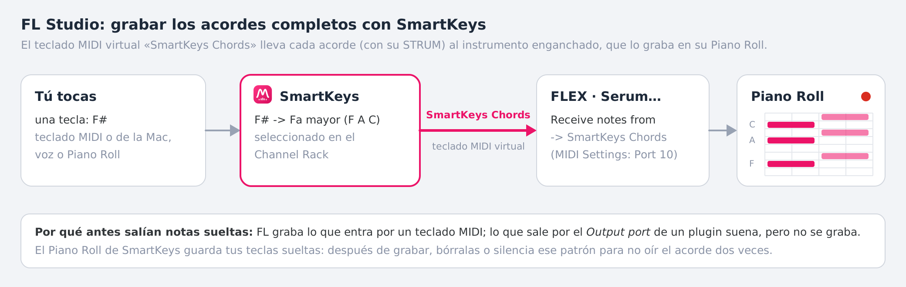

# SmartKeys — Generador de acordes, controlador vocal y contenedor de instrumentos (VST3 / AU / Standalone)

**De MIWN.** Un único plugin de instrumento (JUCE 8, C++17) para FL Studio, Ableton Live y cualquier DAW con VST3 o Audio Unit, y también como app Standalone. Desde la 2.0 es un **contenedor de instrumentos** (estilo Kontakt / PatchWork): carga en su ranura el instrumento que quieras (Serum, Kontakt, Analog Lab…) y le toca los acordes.


- **Cuantiza** cualquier nota (teclado MIDI, teclado de la PC, Piano Roll o tu voz) a la escala elegida: es imposible tocar una nota fuera de escala.
- **SMART CHORDS**: cada tecla dispara el acorde diatónico completo de ese grado (tríada, tríada + octava o cuatriada con 7ª). En Fa Mayor: Do → C Maj, Re → Dm, Mi → E dim.
- **COMPLEX CHORDS**: cada tecla dispara un acorde de 5 a 7 notas a dos manos (R&B / Neo-Soul), con tres variaciones y velocidades balanceadas por voz.
- **Ranura de instrumento (2.0)**: `+ LOAD PLUGIN` carga un instrumento VST3 o Audio Unit dentro de SmartKeys. SmartKeys le toca el **acorde completo** (con el STRUM, exacto a la muestra) y su sonido sale por SmartKeys, con `GAIN`. `SHOW PLUGIN GUI` abre su ventana para elegir sus presets y mover sus perillas; `BYPASS` y `UNLOAD`. Cada tecla sale además como el acorde completo por la salida MIDI (canal 1).
- **STRUM SPEED**: las notas del acorde entran escalonadas, de grave a aguda (`ASC ▲`) o al revés (`DESC ▼`), con una perilla de 0 a 200 ms.
- **Voz → notas y acordes en tiempo real (`MIC VOICE`)**: tarareas y SmartKeys corrige tu voz a la escala, dispara la nota o el acorde del modo elegido, lo toca con el instrumento cargado, lo ilumina en el teclado y lo manda por MIDI. En macOS lee **directamente el micrófono**, sin sidechain ni ruteos. La voz cruda nunca sale por el plugin.
- **43 escalas**: básicas, 21 occidentales, 7 maqam árabes y 12 ragas indias (Hindustani y Carnatic).
- **Presets de SmartKeys**: KEY, SCALE, modo, voicing, STRUM y MIC VOICE, y si quieres también el instrumento con su sonido (una cadena favorita).

---

## Novedades de la versión 2.0.0

**SmartKeys pasa a ser un contenedor de instrumentos.** El piano interno desaparece: en su lugar, una **ranura** en la que cargas cualquier instrumento VST3 o Audio Unit instalado. Todo lo demás sigue igual (KEY y las 43 escalas, SMART / SINGLE / COMPLEX con Lush, Neo-Soul y Cinematic, MIC VOICE con su GATE, STRUM con ASC / DESC, el LIVE KEYBOARD, el teclado *SmartKeys Chords* y los acordes al Piano Roll): ahora todo eso lo toca el instrumento que elijas.

- **Fila INSTRUMENT** (debajo de los modos): `+ LOAD PLUGIN` abre la lista de tus instrumentos (Audio Unit al instante; VST3 tras buscarlos una vez). Al cargarlo dice `Loaded: Serum`. `SHOW PLUGIN GUI` abre o cierra su ventana flotante; `BYPASS` lo calla (suelta sus notas; los acordes siguen saliendo por MIDI); `UNLOAD` lo quita.
- **El instrumento recibe los acordes completos**, exactos a la muestra, con el desfase del STRUM, y su latencia se informa al DAW (FL la compensa). Su sonido (el preset que elegiste en su ventana) se guarda con el proyecto.
- **Presets de SmartKeys** (`PRESET`, a la derecha de la fila): 9 de fábrica y los tuyos. Al guardar puedes incluir el instrumento con su sonido.
- **Sin cierres.** El instrumento se crea, se cambia y se quita sólo en el hilo de mensajes; el audio lo toma con un *try-lock* y nunca espera ni toca un instrumento a medio crear o ya destruido. Si FL se cerrara mientras se carga un instrumento roto, al volver a abrir el proyecto SmartKeys no lo vuelve a cargar solo. Ver [la ranura por dentro](#ranura-de-instrumento-hostedinstrument).
- **No se puede cargar FLEX** (ni Sytrus, FPC…): son instrumentos internos de FL Studio, no plugins VST3 / AU. Para tocar FLEX con SmartKeys usa la forma B de [Grabar los acordes](#b-en-otro-instrumento-flex-serum-kontakt).
- **Un proyecto de la 1.x** se abre con la ranura vacía (antes sonaba el piano interno): carga un instrumento. Un piano siempre disponible en Mac: `Apple › DLSMusicDevice`.

## Novedades de la versión 1.7.0

**Acordes al Piano Roll de SmartKeys.** Hasta ahora, el Piano Roll de SmartKeys guardaba sólo la tecla que pulsabas, y el acorde completo había que grabarlo en otro instrumento. Ahora, con un clic en `MIDI ● SmartKeys Chords` → **Acordes al Piano Roll de SmartKeys**, FL graba el acorde completo en el propio Piano Roll de SmartKeys, y al reproducir SmartKeys toca esas notas tal cual: nada se duplica, ni en bucle ni en otra toma. Se toca en SmartKeys (ratón, teclas de la Mac con su ventana delante o la voz). Ver [Grabar los acordes completos en el Piano Roll](#grabar-los-acordes-completos-en-el-piano-roll-fl-studio).

## Novedades de las versiones 1.6.1 y 1.6.2

- **Corregido el cierre de FL Studio** (`EAccessViolation` en el hilo principal) al quitar o reemplazar el canal de SmartKeys, cerrar el proyecto o apagar el teclado *SmartKeys Chords* en la 1.6.0. Ver [por qué se cerraba](#por-qué-se-cerraba-fl-studio-160).
- **Sin notas dobles al grabar en bucle.** FL vuelve a tocar en cada vuelta lo que ya grabó en el patrón de SmartKeys. Esos acordes salían otra vez por el teclado y FL los grababa encima de los de la vuelta anterior. Ahora, mientras FL graba, una tecla que se repite en la misma posición que en una vuelta anterior de la toma ya no sale por el teclado; lo nuevo que toques, sí. Sin grabar (tocando en vivo sobre un bucle) todo sale como siempre. Y si dos SmartKeys tocan la misma nota a la vez, sale una sola vez.
- **1.6.2: `· REC`.** Mientras FL graba, la etiqueta dice `MIDI ● SmartKeys Chords · REC`: FL le está avisando a SmartKeys de que graba, y la protección contra notas dobles está activa. Si grabas y no aparece, FL no se lo está diciendo (ver [A tener en cuenta](#grabar-los-acordes-completos-en-el-piano-roll-fl-studio)).

## Novedades de la versión 1.6.0

**Los acordes completos, en el Piano Roll.** Al grabar con SmartKeys en FL Studio, el Piano Roll guardaba sólo las teclas que pulsabas (F#4, G#4…), aunque la salida MIDI de SmartKeys ya fuera el acorde completo. La causa: **FL Studio graba en el Piano Roll lo que entra por un teclado MIDI, nunca lo que un plugin manda por su salida MIDI** (por eso Scaler o Cthulhu piden un cable MIDI virtual como loopMIDI o IAC). La 1.6 lo resuelve sin apps externas: **SmartKeys es también un teclado MIDI**, *SmartKeys Chords*. Cada tecla (teclado MIDI, teclado de la PC, voz o las notas del Piano Roll de SmartKeys) sale por él como el **acorde completo**, con el desfase del STRUM. El instrumento que enganches a ese teclado (FLEX, Serum, Kontakt…) suena con los acordes y, al grabar, FL los dibuja **apilados en su Piano Roll**. Ver [Grabar los acordes completos en el Piano Roll](#grabar-los-acordes-completos-en-el-piano-roll-fl-studio).

**Logotipo de MIWN.** Arriba a la izquierda, junto a `SMARTKEYS / FROM MIWN`: una placa rosa (`#EC1368`) con una onda armónica blanca que traza la "M" sobre las barras de nivel de un estudio. Es vectorial (`juce::Path`), así que se ve nítido con cualquier tamaño de ventana.


**`MIDI ● SmartKeys Chords`**, arriba a la derecha: el punto rosa indica que el teclado está activo. Pasa el ratón por encima para ver los pasos de FL Studio; un clic lo apaga o lo enciende (se guarda con el proyecto). En FL Studio y en la app viene encendido; en otros DAW empieza apagado, porque Logic o Ableton meterían cualquier teclado nuevo en la grabación de la pista. Si FL devuelve el teclado al propio SmartKeys, dice `· eco`: SmartKeys ignora ese eco y no se forma ningún bucle.

La 1.5.0 trajo `MIC VOICE` sin sidechain (SmartKeys lee él mismo el micrófono de macOS), la marca MIWN, un único plugin (sin SmartKeys FX) y la salida MIDI fija en el canal 1. La 1.4.0 corrigió el cierre de FL Studio al cerrar la ventana de SmartKeys ([por qué se cerraba](#por-qué-se-cerraba-fl-studio-12--13)). La 1.3.0 dejó el `processBlock` sin asignaciones de memoria y trajo el STRUM de 0 a 200 ms; la 1.2.0, la salida MIDI siempre activa y la ventana redimensionable; la 1.1.0, la limpieza automática de versiones anteriores al instalar.

---

## Descargar los instaladores (sin compilar nada)

GitHub compila y prueba SmartKeys en cada cambio y publica los instaladores en la página **Releases** de este repositorio (**SmartKeys 2.0.0**):

- **Mac:** `SmartKeys-2.0.0-macOS.pkg`. Funciona en Mac con chip Apple e Intel. Instala SmartKeys (VST3, AU y app).
- **Windows:** `SmartKeys-2.0.0-Windows-Setup.exe`. Instala SmartKeys (VST3 y app).

**Los dos instaladores eliminan automáticamente la versión anterior** (y la vieja SmartKeys FX) antes de copiar la nueva. No hace falta borrar nada a mano. El registro de lo que se borró en Mac queda en `/tmp/smartkeys-install.log`.

En Mac, el `.pkg` no está firmado con un certificado de Apple. La primera vez, macOS dirá que no puede verificar al desarrollador. Para abrirlo, ve a **Ajustes del Sistema → Privacidad y seguridad → "Abrir igualmente"** y vuelve a abrir el `.pkg`. Después, en FL Studio: **Options → Manage plugins → Find installed plugins**.

---

## Instalar desde el código con un solo comando

### macOS: borra la versión vieja, compila e instala

```bash
bash Installer/install_mac.sh
```

1. Comprueba las Command Line Tools de Apple y CMake (si falta CMake, lo instala con Homebrew o solo para tu usuario).
2. Borra SmartKeys y la vieja SmartKeys FX (`.vst3`, `.component`, `.app`) de `/Library`, de `~/Library` de cada usuario y de `/Applications`. También borra la caché de Audio Units y la ficha de FL Studio.
3. Compila en `Release` el binario Universal y genera `Installer/Output/SmartKeys-2.0.0-macOS.pkg`.
4. Instala el `.pkg` y reinicia `AudioComponentRegistrar` para que FL Studio y Ableton vean el binario nuevo.

Te pide la contraseña de administrador en los pasos 2 y 4. Para desinstalar todo: `bash Installer/uninstall_mac.sh`.

### Windows

```bat
Installer\build_windows.bat
```

Compila, genera `SmartKeys-2.0.0-Windows-Setup.exe` y lo ejecuta. El instalador borra antes la versión anterior. Requisitos: Visual Studio 2022 con "Desarrollo para escritorio con C++", CMake 3.22+, Git e [Inno Setup 6.3+](https://jrsoftware.org/isdl.php). Añade `noinstall` para solo generar el `.exe`.

### Para desarrolladores: copiar al compilar

```bash
cmake -B build -DCMAKE_BUILD_TYPE=Release -DSMARTKEYS_COPY_AFTER_BUILD=ON
cmake --build build --config Release
```

Con `SMARTKEYS_COPY_AFTER_BUILD=ON`, cada compilación hace tres cosas:

- **Antes de copiar** (PRE_BUILD) borra el `.vst3` y el `.component` anteriores de las carpetas de plugins de tu usuario.
- Copia los nuevos (`COPY_PLUGIN_AFTER_BUILD`).
- En Mac, al terminar (POST_BUILD), reinicia `AudioComponentRegistrar`.

Está desactivado por defecto para no dejar una segunda copia en `~/Library` junto a la que instala el `.pkg` en `/Library` (dos copias son justo lo que hace que el DAW cargue una versión vieja). JUCE 8.0.15 se descarga automáticamente; con `-DJUCE_DIR=/ruta/a/JUCE` se usa una copia local.

---

## Uso en el DAW

### Tocar
Carga **SmartKeys** como instrumento: en FL Studio va en el Channel Rack y en Ableton en una pista MIDI. Carga un instrumento en su ranura (`+ LOAD PLUGIN`), elige **KEY** y **SCALE** y toca. Con un clic en las notas de la barra **ESCALA** puedes activarlas o desactivarlas. El teclado de abajo ilumina las notas que suenan y el display muestra el acorde (`Dm`, `Gm7`, `F Maj9`…).

### La ranura de instrumento (`+ LOAD PLUGIN`)
SmartKeys no tiene sonido propio: suena el instrumento que cargues en su ranura, en la fila **INSTRUMENT**.

1. Clic en **`+ LOAD PLUGIN`**. Se abre la lista de instrumentos instalados:
   - **Audio Unit** (Mac): todos los instrumentos del sistema, al instante (la lista no abre ningún plugin). Con muchos, van agrupados por fabricante.
   - **VST3**: la primera vez, **Buscar instrumentos VST3 nuevos** (en Windows empieza sola). La búsqueda avanza de uno en uno y la ranura muestra el progreso; vuelve a abrir el menú al terminar. La lista se guarda: la próxima vez sale al instante. **Volver a buscar todos los VST3** la rehace.
2. Elige el instrumento. La ranura dice `Cargando Serum…` y después **`Loaded: Serum`**, con el formato y el fabricante debajo.
3. **`SHOW PLUGIN GUI`** abre la **ventana del instrumento** junto a la de SmartKeys (vuelve a pulsarlo, `HIDE PLUGIN GUI`, para cerrarla). Ahí eliges **sus presets** y mueves sus perillas, como siempre.
4. **`BYPASS`** calla el instrumento al instante (suelta todas sus notas, sin dejar ninguna colgada); los acordes siguen saliendo por MIDI. **`UNLOAD`** lo quita de la ranura.

`GAIN` ajusta el volumen del instrumento (−60 a +6 dB). El instrumento cargado, su sonido (el preset que elegiste en su ventana) y su `BYPASS` se guardan con el proyecto. Si el proyecto se abre en una computadora que no tiene ese instrumento, la ranura lo dice (`no está instalado`) y lo **conserva**: al guardar no se pierde, y en la computadora que lo tenga sonará con su sonido.

**Abrir la ventana del instrumento en FL Studio:** abre SmartKeys (clic en su botón del Channel Rack) → fila **INSTRUMENT** → **`SHOW PLUGIN GUI`**. La ventana flota sobre FL Studio, se oculta cuando cambias a otra aplicación y se cierra con la de SmartKeys; si la tenías abierta, vuelve a abrirse la próxima vez que abras SmartKeys.

**Qué instrumentos:** cualquier instrumento **VST3** (Mac y Windows) o **Audio Unit** (Mac). Los instrumentos propios de FL Studio (FLEX, Sytrus, FPC, 3x Osc…) no son plugins y no se pueden cargar en ningún otro plugin: para tocarlos con SmartKeys, usa la [forma B](#b-en-otro-instrumento-flex-serum-kontakt). En Mac siempre tienes un piano General MIDI: `Apple › DLSMusicDevice`.

**Si algo falla:** `No se pudo cargar…` en la ranura (el que había sigue sonando). Si FL Studio se cerrara mientras se carga un instrumento, al volver a abrir el proyecto SmartKeys **no lo vuelve a cargar solo** (`Se cerró el programa al cargarlo`): clic en la ranura → **Reintentar**. Si un instrumento devuelve audio no válido (NaN), SmartKeys silencia ese momento en lugar de pasarlo a la mezcla.

### Presets de SmartKeys (`PRESET`)
A la derecha de la fila INSTRUMENT. Un preset guarda **KEY, SCALE** (y las notas activadas a mano en la barra ESCALA), el **modo**, el **voicing** (`TRIAD / +8VA / 7TH`), el **estilo COMPLEX** (Lush, Neo-Soul, Cinematic), **STRUM SPEED + ASC/DESC** y **MIC VOICE + GATE**. `GAIN` no, porque es de la mezcla.

- **Cargar:** clic en `PRESET` y elige uno: 9 de fábrica (Pop, Ballad, Neo-Soul, Lush, Cinematic, Harp, Maqam Hijaz, Raga Bhairavi, Voice to Chords) y los tuyos.
- **Guardar:** `PRESET` → **Guardar preset…**, escribe el nombre y pulsa Enter. Marca **Incluir *el instrumento* con su sonido** para guardar una **cadena favorita**: al cargarla, SmartKeys pone también ese instrumento con su preset.
- **Borrar** el tuyo actual, o **Abrir la carpeta de presets** (`~/Library/Application Support/MIWN/SmartKeys/Presets` en Mac, `%APPDATA%\MIWN\SmartKeys\Presets` en Windows; son archivos `.skpreset`).

Los presets del propio instrumento se eligen en **su** ventana (`SHOW PLUGIN GUI`), por separado.

### El instrumento cargado + salida MIDI
SmartKeys **siempre** hace las dos cosas a la vez:

- El instrumento de la ranura toca los acordes. `GAIN` ajusta su volumen (−60 a +6 dB).
- Cada tecla sale por la salida MIDI del plugin como el **acorde completo** (3, 4 o 5–7 notas), con su STRUM, para tocar cualquier otro plugin.

Los acordes salen siempre por el **canal MIDI 1**. El **puerto** MIDI lo asigna el DAW:

- **FL Studio:** para que otro instrumento **suene y grabe** los acordes, usa el teclado *SmartKeys Chords* ([siguiente apartado](#grabar-los-acordes-completos-en-el-piano-roll-fl-studio)). La vía del wrapper también lo hace sonar, pero FL no graba lo que llega así: en SmartKeys, engranaje ⚙ (*Fruity Wrapper*) → MIDI → **Output port** = 1; en el plugin destino, **Input port** = 1. Usa una vía u otra, no las dos. Si sólo quieres oír el otro plugin, deja la ranura de SmartKeys vacía o en `BYPASS`.
- **Ableton Live:** crea otra pista MIDI con *MIDI From* = `SmartKeys` y pon en ella el instrumento destino. Ableton sí graba en esa pista los acordes completos.

### Grabar los acordes completos en el Piano Roll (FL Studio)

FL Studio graba en el Piano Roll lo que llega por un **teclado MIDI**, nunca lo que un plugin manda por su salida MIDI. Por eso SmartKeys también es un teclado: **SmartKeys Chords** (macOS). Todo acorde que sale de SmartKeys sale también por ese teclado, con su desfase de STRUM, como si tocaras todas sus notas en un teclado real. Hay dos formas de grabarlo; se elige con un clic en `MIDI ● SmartKeys Chords`, arriba a la derecha.

#### A. En el Piano Roll de SmartKeys (`Acordes al Piano Roll de SmartKeys`)

El Piano Roll de SmartKeys guarda el **acorde completo** (por ejemplo F3 A3 C4), no la tecla que pulsas.

1. Clic en `MIDI ● SmartKeys Chords` → **Acordes al Piano Roll de SmartKeys**. La etiqueta dice `· Piano Roll`.
2. **Options → MIDI Settings → Input**: selecciona **SmartKeys Chords** y activa **Enable**. Si no está en la lista, pulsa **Refresh device list**.
3. Deja **seleccionado SmartKeys** en el Channel Rack. Para que lo reciba aunque selecciones otro canal: ponle un **Port** en el paso 2 y haz clic derecho en SmartKeys → **Receive notes from** → **SmartKeys Chords**.
4. Apaga el teclado de escritura de FL (**Typing keyboard to piano keyboard**, en la barra de herramientas) y **toca en SmartKeys**: con el ratón en su teclado, con las teclas de la Mac `A W S E D F T G Y H U J K` (`Z` / `X`: octava) con la ventana de SmartKeys delante, o con la voz (`MIC VOICE`).
5. Pulsa grabar (●) y toca: el Piano Roll de SmartKeys se llena con todas las notas de cada acorde, apiladas (con STRUM, escalonadas).

Al reproducir, SmartKeys toca las notas de su Piano Roll **tal cual**: no las convierte otra vez en acordes ni las vuelve a mandar por el teclado, así que **nada se graba doble**, ni con el patrón en bucle ni en otra toma.

- **Por qué hay que tocar en SmartKeys:** FL graba siempre lo que entra por **su** teclado (el de escritura o un teclado MIDI conectado a FL), y ningún plugin puede evitarlo. En este modo, una tecla que llega desde FL suena tal cual, sin acorde, y la etiqueta avisa `· toca en SmartKeys`.
- **Si la etiqueta dice `· FL no lo recibe`**, lo que SmartKeys manda no le llega a FL: revisa los pasos 2 y 3.
- **Los acordes que FL ya grabó** se editan en el Piano Roll como cualquier nota: SmartKeys los toca como están.

#### B. En otro instrumento (FLEX, Serum, Kontakt…)

1. Clic en `MIDI ● SmartKeys Chords` → **Acordes a otro instrumento**. Si dice `· OFF`, enciéndelo así.
2. **Options → MIDI Settings → Input**: selecciona **SmartKeys Chords**, activa **Enable** y ponle un **Port** libre, por ejemplo `10` (sin Port no aparece en el menú del paso 3). Si no está en la lista, pulsa **Refresh device list**.
3. En el Channel Rack, **clic derecho** en el instrumento que quieres tocar y grabar (FLEX, Serum, Kontakt…) → **Receive notes from** → **SmartKeys Chords** (*All MIDI channels*). Su botón muestra un candado: recibe los acordes aunque el canal seleccionado sea otro.
4. Deja **seleccionado SmartKeys** y toca como siempre: teclado MIDI, teclado de la Mac, tu voz (`MIC VOICE`) o las notas de su Piano Roll al darle ▶. El instrumento enganchado suena con el acorde completo.
5. Pulsa grabar (●) y toca: el Piano Roll **del instrumento enganchado** se llena con todas las notas de cada acorde, apiladas (con STRUM, escalonadas).



En esta forma:

- **El Piano Roll de SmartKeys guarda tus teclas sueltas**, que son lo que entró por tu teclado, y FL las vuelve a tocar en cada vuelta del patrón. **Grabando en bucle no pasa nada:** mientras la etiqueta dice `· REC`, lo que FL repite en cada vuelta no vuelve a salir por el teclado, así que no se graba doble. **Al reproducir sin grabar**, esas teclas vuelven a tocar el acorde en el instrumento enganchado (que ya lo tiene grabado) y lo oirías dos veces: después de grabar, borra las teclas de SmartKeys o silencia su patrón. En una toma nueva, haz lo mismo antes de grabar.
- **Si grabas y no aparece `· REC`**, FL no le está avisando a SmartKeys de que graba, y desde la segunda vuelta del bucle los acordes se grabarían otra vez. Graba una vuelta cada vez (para al terminarla), o en modo **SONG** sobre una zona vacía del Playlist, donde nada se repite.
- **Convertir en acordes las notas sueltas que ya tienes** en el Piano Roll de SmartKeys: engancha el instrumento (pasos 2–3), pon FL a grabar y dale ▶. SmartKeys toca esas notas como acordes y FL los graba en el instrumento enganchado.
- **Una sola vía hacia cada instrumento:** este teclado **o** el *Output port* del wrapper. Con las dos, el acorde le llega dos veces. El Port del paso 2 no debe coincidir con el *Input port* del wrapper de SmartKeys.
- **Si te saltas el paso 3** (teclado activado y SmartKeys seleccionado), FL devuelve los acordes al propio SmartKeys. SmartKeys los reconoce como **eco** y los ignora (la etiqueta dice `· eco`), pero así ningún otro instrumento los graba. Si lo que quieres es tener los acordes en el Piano Roll de SmartKeys, usa la forma A.

En las dos:

- **Al reabrir FL Studio**, el teclado aparece cuando se carga el proyecto con SmartKeys. FL recuerda su Port; si el instrumento no recibe nada, pulsa **Refresh device list** en MIDI Settings.
- **Exportar:** al renderizar (fuera de tiempo real) el teclado no envía nada. Exporta con las notas ya grabadas en el instrumento, o con la vía del wrapper.
- **Octavas:** FL numera una octava más arriba que SmartKeys. El Do central (MIDI 60) es C4 en SmartKeys y C5 en FL, así que el `F2 A2 C3` del display aparece como F3 A3 C4 en el Piano Roll de FL.
- **App Standalone:** su teclado se llama *SmartKeys Chords (App)*, para no chocar con el del DAW.
- **Otros DAW:** el teclado empieza apagado (clic en `MIDI · OFF` para encenderlo). Ableton graba directamente la salida MIDI de SmartKeys en otra pista (*MIDI From* = SmartKeys), así que ahí no hace falta.
- **Windows:** un plugin no puede crear teclados MIDI virtuales. Ahí hace falta un cable MIDI virtual (loopMIDI): en *MIDI Settings → Output* activa loopMIDI con un Port (por ejemplo `11`) y pon ese número en el *Output port* del wrapper de SmartKeys; en *Input* activa loopMIDI con otro Port y engánchalo al instrumento con *Receive notes from* (pasos 3–5).

### STRUM SPEED (entrada progresiva de las notas)
La perilla **STRUM SPEED** (debajo del display) va de `OFF` a 200 ms:

- En `OFF` todas las notas del acorde entran a la vez.
- Al subirla, la nota *i* entra con un retardo `i · base · (1 + 0.15·i)`. Cada nota tarda un poco más que la anterior, como un pianista que desgrana el acorde.
- `ASC ▲` entra de la más grave a la más aguda (F4 → A4 → C5); `DESC ▼`, al revés (C5 → A4 → F4).
- Si sueltas la tecla antes de que entren todas, las que faltaban se cancelan y las que sonaban se apagan juntas: nunca quedan notas colgadas.
- Funciona en el instrumento cargado (recibe cada nota en la muestra exacta del barrido), en la salida MIDI, en el teclado *SmartKeys Chords* y con la voz, y el `LIVE KEYBOARD` enciende las teclas una a una. Doble clic en la perilla: `OFF`.

### Controlador vocal (MIC VOICE)

1. Carga **SmartKeys** como instrumento normal (Channel Rack de FL Studio, pista MIDI de Ableton). No hace falta ningún ruteo.
2. Pulsa **`MIC VOICE: ON`** y tararea. El medidor LED se mueve con tu voz y, a la derecha de `GATE`, aparece lo que estás disparando: `Mic: A3 -> Acorde: Am` (en SINGLE NOTES: `Mic: A3 -> Nota: A3`).
3. Tu voz se corrige a `KEY` y `SCALE` (como un Auto-Tune) y dispara la nota o el acorde del modo (`SINGLE NOTES`, `SMART CHORDS` o `COMPLEX CHORDS`): lo toca el instrumento cargado, se ilumina en el `LIVE KEYBOARD` y sale por MIDI.
4. `GATE` (por defecto −48 dB) es el umbral: por debajo, la voz no dispara nada. Si el micrófono capta ruido, súbelo; si tarareas bajito, bájalo.

**De dónde escucha (macOS):**
- **La entrada de audio activa de macOS**, canal 1: la que eliges en **Ajustes del Sistema → Sonido → Entrada** (el micrófono de la Mac o tu interfaz). Pasa el ratón sobre `Mic:` para ver cuál está usando.
- Si el DAW le manda audio por la entrada del plugin (sidechain), usa esa en su lugar, y vuelve al micrófono de macOS cuando esa entrada se queda en silencio.
- **Permiso:** la primera vez, macOS pregunta si **FL Studio** (el DAW, no SmartKeys) puede usar el micrófono: pulsa *Permitir*. Si antes lo negaste, la etiqueta lo dice; actívalo en **Ajustes del Sistema → Privacidad y seguridad → Micrófono → FL Studio** y vuelve a abrir FL Studio.
- **Auriculares Bluetooth (AirPods):** su micrófono no se abre, porque macOS los cambiaría a modo llamada y el sonido de FL Studio empeoraría. Si la entrada de macOS son unos AirPods, SmartKeys usa el micrófono de la Mac.
- **Standalone:** la app usa la entrada elegida en *Options → Audio/MIDI Settings*; si esa entrada no trae audio, también lee el micrófono de macOS.

**Windows:** la voz entra por la entrada sidechain del plugin (en FL Studio, la pista del micrófono enviada como sidechain al canal de SmartKeys; en Ableton, el panel *Sidechain* del dispositivo).

---

## Controles

| Control | Función |
|---|---|
| `SMART CHORDS / SINGLE NOTES / COMPLEX CHORDS` | Acorde diatónico (3–4 notas), nota individual cuantizada, o acorde a dos manos (5–7 notas) |
| `GAIN` | Volumen del instrumento cargado (−60 a +6 dB); la salida MIDI no cambia |
| `+ LOAD PLUGIN` / `Loaded: Serum` | Ranura de instrumento (2.0): clic = lista de instrumentos VST3 / Audio Unit (buscar VST3, reintentar, quitar) |
| `SHOW PLUGIN GUI` / `HIDE PLUGIN GUI` | Abre o cierra la ventana flotante del instrumento cargado (sus presets y perillas) |
| `BYPASS` · `UNLOAD` | Calla el instrumento (suelta sus notas; el MIDI sigue saliendo) · lo quita de la ranura |
| `PRESET` | Presets de SmartKeys: de fábrica y tuyos; guardar (con o sin el instrumento), borrar, abrir la carpeta |
| `MIDI ● SmartKeys Chords` | Teclado MIDI virtual (macOS): `●` activo, `○` esperando a que suene el plugin, `· en uso` (otra app lo tiene), `· eco` (FL lo devuelve a SmartKeys), `· REC` (FL graba y se lo dice a SmartKeys: lo que repite el bucle no sale otra vez), `· Piano Roll` (los acordes se graban en el Piano Roll de SmartKeys), `· FL no lo recibe`, `· toca en SmartKeys`, `· OFF` apagado. Clic: menú (acordes al Piano Roll de SmartKeys / a otro instrumento / apagado). Pasa el ratón para ver los pasos de FL Studio |
| `MIC VOICE` | Activa la voz: el micrófono de macOS (o la entrada sidechain si el DAW la manda) |
| Medidor · `GATE` · `Mic: A3 -> Acorde: Am` | Nivel de la voz, umbral del gate y la nota y el acorde que dispara en vivo |
| `KEY` · `SCALE` · barra `ESCALA` | Tónica, escala (`Más escalas`: Occidentales / Árabes / Indias) y notas activas una a una |
| `TRIAD / +8VA / 7TH` | Grados k, k+2, k+4 · + octava · + séptima (en SMART CHORDS) |
| `LUSH 7/9 / NEO-SOUL / CINEMATIC` | Variación de COMPLEX CHORDS (aparece en ese modo) |
| `STRUM SPEED` · `ASC ▲ / DESC ▼` | Entrada progresiva de las notas del acorde (0–200 ms) y su dirección |
| Teclado PC | `A W S E D F T G Y H U J K` = una octava, `Z / X` = bajar/subir octava |

---

## Modo COMPLEX CHORDS


La tecla (MIDI, teclado de la PC, Piano Roll o voz) se cuantiza a la escala (`d0`, índice `k`) y genera:

| Voz | 7th & 9th Lush | 9th & 11th Neo-Soul | Cinematic Spread Add9 | Velocidad |
|---|---|---|---|---|
| Mano izquierda | `d0 − 12`, `(k+4) − 12` | `d0 − 12`, `(k+4) − 12` | `d0 − 12`, `(k+4) − 12` | 95 % |
| Mano derecha | `k`, `k+2`, `k+6`, `k+8` | `k`, `k+2`, `k+6`, `k+8` | `k`, `k+8` (add9), `k+9` (10ª) | 80 % |
| Voz superior | `k+11` (5ª arriba) | `k+10` (11ª) | `k+11` (12ª), `k+14` (raíz +2 octavas) | 90 % (la más aguda) |

Progresión de **Fa Mayor** (I–vii, tecla en la 4ª octava, 7 notas por acorde):

| Variación | I | ii | iii | IV | V | vi | vii |
|---|---|---|---|---|---|---|---|
| Lush | F Maj9 | Gm9 | Am7(11) | Bb Maj9 | C9 | Dm9 | Em7b5 |
| Neo-Soul | F Maj13 | Gm11 | Am7(11) | Bb Maj9#11 | C13 | Dm11 | Em7b5(11) |
| Cinematic | Fadd9 | Gm(add9) | Am(add11) | Bbadd9 | Cadd9 | Dm(add9) | E dim |

**Regla anti-choques (avoid notes).** Si una extensión cae a 1 semitono (2ª menor) o a 13 semitonos (9ª menor) de otra voz, se sustituye por el siguiente candidato **diatónico**:
- 11ª natural sobre 3ª mayor → 13ª. Por eso sale F Maj13 y no "F Maj11".
- b9 → 11ª u octava.
- En Cinematic sobre acordes menores, la 9ª se sube una octava.

Las notas siempre pertenecen a la escala activa (verificado en 198 144 voicings).

**Velocity voicing:**
- Mano izquierda: 95 %.
- Voces centrales: 80 %.
- Voz superior: 90 %.

**Polifonía:** la del instrumento cargado. SmartKeys le manda cada nota una sola vez aunque dos acordes la compartan (4 acordes de 7 notas sostenidos = 20 a 28 notas).

**MIDI:** el buffer de salida se reemplaza (`swapWith`) por el acorde completo. `ActiveNoteRegistry` guarda las notas de cada tecla para soltarlas todas con el NoteOff, aunque cambies de modo o de escala con la tecla pulsada.

---

## Decisiones técnicas

### Ranura de instrumento (`HostedInstrument`)

SmartKeys 2.0 carga el instrumento con el sistema de *hosting* de JUCE 8 (`AudioPluginFormatManager` con VST3 en todos los sistemas y Audio Unit en Mac; `AudioPluginInstance`). Las reglas:

- **Sólo el hilo de mensajes crea, cambia y destruye el instrumento.** La carga es asíncrona (`createPluginInstanceAsync`; un Audio Unit v3 puede contestar desde otro hilo y el resultado se lleva al hilo de mensajes). Una carga que llega tarde (después se pidió otro o se quitó) se descarta. Lo que el DAW pide a SmartKeys desde otro hilo (`prepareToPlay`, `get/setStateInformation`) se apunta en atómicos y lo aplica un temporizador en el hilo de mensajes.
- **El hilo de audio nunca espera.** `processBlock` toma el instrumento con un *try-lock* (`juce::SpinLock::ScopedTryLockType`). El hilo de mensajes sólo sujeta ese candado para cambiar un puntero (poner o quitar el instrumento, o apartarlo mientras se prepara). Si en ese instante lo tiene, ese bloque sale en silencio: el audio nunca toca un instrumento a medio crear, a medio preparar o ya destruido, y nunca se queda esperando al hilo de mensajes.
- **Orden al cambiar o quitar:** se cierra su ventana (su editor se destruye antes que el plugin), el audio lo suelta (candado), se libera (`releaseResources`) y se destruye, todo en el hilo de mensajes.
- **MIDI:** el instrumento recibe una copia de los acordes completos de la salida (con STRUM, CC, pedal, pitch bend), en un `MidiBuffer` reservado. Si el DAW manda un bloque más grande que el preparado, se procesa en trozos con cada evento en su muestra. SmartKeys lleva la cuenta de las notas que tiene encendidas el instrumento: en `BYPASS`, al reiniciar el audio o en el bypass del propio SmartKeys le manda sus NoteOff, pedal arriba y *All Notes Off*, y lo calla con un fundido de un bloque. Ninguna nota se queda colgada.
- **Buses:** se le pide salida principal estéreo (o mono) sin entradas ni salidas auxiliares; si el plugin no lo admite, se usa su disposición y se toma la salida principal.
- **Latencia:** `setLatencySamples (latencia del instrumento)`, también cuando el instrumento la cambia (lo avisa con `audioProcessorChanged`); el aviso al DAW sale del temporizador, nunca dentro de `prepareToPlay`.
- **Estado:** el proyecto guarda la descripción del plugin (`PluginDescription`), su estado (base64) y el `BYPASS`, en un nodo `HostedPlugin` aparte de los parámetros. Si el DAW guarda desde otro hilo, SmartKeys contesta con una copia que se renueva cuando se deja de tocar el plugin y al cerrar su ventana. Al abrir un proyecto con el mismo instrumento ya cargado, sólo se le pasa su estado (la ventana sigue abierta). Si falta, se conserva tal cual.
- **Carga protegida:** antes de crear un plugin se apunta en `Cargando plugin.txt` (carpeta de datos de SmartKeys) y se borra al terminar. Si FL se cierra a mitad, el apunte queda: la próxima vez ese plugin no se vuelve a cargar solo al abrir el proyecto (la ranura lo dice y se puede reintentar). Igual en la búsqueda de VST3 (un plugin que cierra el programa al examinarlo queda en la lista negra).
- **Catálogo** (`PluginCatalog`, uno por proceso): los Audio Unit salen del registro de componentes (`AudioComponentFindNext`) sin abrir ninguno; los VST3 se examinan uno por tic del temporizador (muchos traen `moduleinfo.json` y se describen sin cargarlos) y la lista se guarda en disco. SmartKeys no se ofrece a sí mismo.
- **La ventana del instrumento** es una `DocumentWindow` con su editor (`createEditorAndMakeActive()`, el nombre en JUCE 8 de `createEditorIfNeeded()`), siempre encima, junto a la de SmartKeys; en Mac se oculta cuando FL pasa a segundo plano. Un plugin sin interfaz muestra sus parámetros (`GenericAudioProcessorEditor`).
- **Audio no válido:** si el instrumento devuelve NaN o infinito, ese bloque sale en silencio.
- **La app Standalone** está firmada con `com.apple.security.cs.disable-library-validation`: con el Hardened Runtime, macOS no la dejaría cargar plugins de otros fabricantes.

### Por qué se cerraba FL Studio (1.2 – 1.3)

C++ destruye los miembros de una clase en el orden inverso al que se declaran. En el editor de la 1.2 y la 1.3, el enlace de la perilla STRUM SPEED con su parámetro estaba declarado **antes** que la perilla. Al cerrar la ventana:

1. Se destruía primero la perilla (`juce::Slider`).
2. Después se destruía el enlace, que llamaba a `strumKnob.removeListener (this)` sobre la perilla ya destruida.

Ese acceso a memoria liberada pasaba cada vez que se cerraba la ventana de SmartKeys. En FL Studio para Mac a veces escribía sobre memoria ya reutilizada. Eso dañaba el montón, y macOS lo detectaba más tarde en otra parte: el cierre `nanov2_guard_corruption_detected` de la 1.2. Otras veces fallaba en el acto: el `EAccessViolation` de la 1.3, en `~SmartKeysAudioProcessorEditor → Slider::removeListener`. Las direcciones del informe de FL se tradujeron con el binario 1.3.0 exacto (mismo UUID) y llevan a esas funciones.

**Cómo se encontró y se comprobó.** `pluginval` abre y cierra el editor muchas veces. Ejecutado sobre el VST3 compilado con AddressSanitizer, falla con la 1.3 en la primera prueba de editor, con la misma pila. pluginval sin sanitizer no lo veía, porque leer memoria liberada no siempre falla.

**Corrección (tres capas):**
- En el editor, los enlaces se declaran **después** de todos los controles, así que se destruyen antes que ellos.
- El destructor del editor para el temporizador y destruye los enlaces explícitamente, antes que nada más.
- Cada enlace guarda su control con un `Component::SafePointer`. Si el control ya no existe, el enlace no lo toca.

Además, `setSize()` es la última línea del constructor del editor, y el destructor suelta cualquier nota que el ratón o el teclado de la PC dejaran pulsada.

### Micrófono del sistema sin sidechain (`SystemMicInput`)

El instrumento de FL Studio no recibe el micrófono por su entrada sin un ruteo de sidechain, así que SmartKeys lo lee él mismo, con estas reglas:

- **Sólo entrada.** Un `IOProc` de CoreAudio sobre la entrada activa de macOS, con **0 canales de salida** (el uso de flujos del IOProc deja la salida apagada) y sólo el primer flujo de entrada (canal 1). CoreAudio admite varios clientes por dispositivo: FL Studio sigue con su audio como si nada.
- **Nunca cambia el dispositivo.** No toca la frecuencia de muestreo ni el tamaño de búfer: lee el micrófono tal como está. Si el micrófono va a 48 kHz y FL a 44.1 kHz, el detector de voz trabaja a 48 kHz (no se remuestrea nada).
- **Sin candados entre hilos.** El hilo de CoreAudio sólo copia el canal 1 a un búfer circular fijo (`std::array<float, 16384> micRingBuffer` + `std::atomic` `writeIndex` / `readIndex`, un productor y un consumidor). El `processBlock` lo vacía en cada bloque en un arreglo fijo: ni `std::vector`, ni `malloc`, ni `realloc`. Si el DAW deja de pedir audio un rato, se descarta lo viejo (la latencia no se acumula). 16 384 muestras (341 ms a 48 kHz) caben aunque FL use un búfer grande.
- **Elección de la fuente en cada bloque.** Si por la entrada del plugin llega cualquier muestra por encima de −120 dBFS, la voz es esa (sidechain). Tras 0,5 s de silencio digital, el micrófono del sistema. El micrófono se abre sólo cuando hace falta (`MIC VOICE: ON` y el DAW no manda voz) y se cierra al apagar `MIC VOICE`. En una exportación (render offline) se ignora.
- **Permiso.** Se pide con el aviso oficial de macOS (`AVCaptureDevice`); macOS lo concede a la aplicación anfitriona (FL Studio). Si el anfitrión no declara `NSMicrophoneUsageDescription` en su `Info.plist`, el micrófono no se toca, porque macOS cerraría el programa. El plugin también lo declara en su `Info.plist`.
- **Bluetooth.** Una entrada Bluetooth no se abre (cambiaría los auriculares a modo llamada y el audio de salida del DAW); se usa el micrófono de la Mac si existe.
- **Vigilancia.** Un temporizador del procesador (4 veces por segundo, hilo de mensajes) reabre el micrófono si cambias la entrada en Ajustes, si se desconecta la interfaz o si deja de entregar audio, y lo cierra antes de destruir el plugin.
- **Windows:** sin lectura directa; la voz entra por la entrada sidechain del plugin.

### Por qué se cerraba FL Studio (1.6.0)

El informe de FL (`EAccessViolation`, hilo principal, `libobjc` ← `Foundation` ← `SmartKeys` ← `Fruity Wrapper`) se tradujo con el binario 1.6.0 exacto: `~JuceVST3Component` → `~SmartKeysAudioProcessor` → `~ChordMidiPort` → `[[NSProcessInfo processInfo] endActivity: …]`.

En la 1.6.0, el teclado *SmartKeys Chords* pedía a macOS que no pusiera el proceso en App Nap con `juce::ScopedLowPowerModeDisabler`. Esa clase de JUCE guarda la "actividad" de `NSProcessInfo` sin retenerla. macOS la libera al terminar la vuelta del bucle de mensajes, y al destruir el teclado (último SmartKeys quitado o reemplazado, proyecto cerrado o teclado apagado) se enviaba `endActivity:` a un objeto ya liberado.

En la 1.6.1 el teclado ya no usa App Nap: su hilo es de tiempo real y FL Studio, que está reproduciendo audio, no entra en App Nap. Las pruebas de la Mac de la CI corren ahora con `NSZombieEnabled`, que hace fallar en el acto cualquier mensaje a un objeto liberado, y pluginval crea y destruye el plugin una y otra vez con el teclado encendido.

### Teclado MIDI virtual "SmartKeys Chords" (`ChordMidiPort`)

- **Por qué hace falta.** FL Studio graba en el Piano Roll las notas que llegan por un dispositivo MIDI de entrada. Lo que un plugin manda por su salida MIDI (el *Output port* del wrapper) hace sonar a otro plugin, pero no se graba. La salida MIDI de SmartKeys ya era el acorde completo, exacto a la muestra (las pruebas lo comprobaban); faltaba que llegara a FL como un teclado.
- **Cuándo.** Encendido por defecto en FL Studio (`PluginHostType::isFruityLoops()`) y en la app Standalone, donde un teclado sólo se usa si lo activas tú. En otros DAW empieza apagado: Logic, Cubase o Ableton meten cualquier teclado nuevo en la entrada de la pista y grabarían los acordes junto a tus teclas. Un clic en la etiqueta lo cambia, y se guarda con el proyecto.
- **Qué es.** `juce::MidiOutput::createNewDevice ("SmartKeys Chords")` crea una fuente CoreMIDI del sistema. Su identificador sale de `com.miwn.smartkeys` y el nombre, y es siempre el mismo, así que FL Studio recuerda su Port de una sesión a otra. Hay uno por proceso (`SharedResourcePointer`), compartido por todas las instancias. La app Standalone usa `SmartKeys Chords (App)` para no chocar con el del DAW. Se crea en el hilo de mensajes cuando el plugin se usa de verdad (el DAW lo pone a sonar o se abre su ventana), nunca durante el escaneo de plugins. Si otra aplicación ya lo tiene, se reintenta cada 3 s.
- **Tiempo real.** El hilo de audio sólo copia los NoteOn/NoteOff del camino del teclado (ya con el STRUM) a un FIFO lock-free de tamaño fijo, con su hora: inicio del bloque + un bloque + su posición. Un hilo propio vacía el FIFO cada ~1 ms y envía cada nota a su hora, así el teclado lleva el mismo desfase que la salida MIDI. Ni candados, ni memoria dinámica, ni CoreMIDI en el hilo de audio.
- **Ninguna nota colgada ni doble.** El teclado lleva la cuenta de lo que cada instancia dejó sonando. Al poner el bypass, reiniciar el audio o cerrar el plugin, envía sus NoteOff. Si dos instancias tocan la misma nota, sale una sola vez y se apaga cuando la suelta la última.
- **Grabación en bucle.** El teclado tiene su propio router y su propio STRUM, a los que sólo llegan las teclas que deben salir por él. Mientras el DAW graba (y se lo dice al plugin: `isRecording`; la etiqueta muestra `· REC`), SmartKeys anota en qué posición (en negras) salió cada tecla y en qué vuelta del bucle (una vuelta nueva empieza cuando la posición salta hacia atrás). Si FL repite una tecla en la misma posición (±1 semicorchea, por si FL cuantiza al grabar) que en una vuelta anterior de la misma toma, está tocando lo que ya grabó en el patrón de SmartKeys, y ese acorde no sale otra vez: el instrumento enganchado ya lo tiene grabado. Sin grabar no se filtra nada: al tocar en vivo sobre un bucle, repetir un acorde en el mismo sitio de cada vuelta es lo normal. Si el DAW no corta el bloque de audio justo al final del bucle, la primera nota de la vuelta siguiente llega en un bloque que empezó antes del final, con una posición «de más»: SmartKeys aprende dónde termina el bucle en la primera vuelta (o lo sabe desde el principio si el DAW anuncia sus puntos de bucle) y la reconoce igual. En una toma nueva, la primera vuelta sale entera. La salida MIDI y el piano de SmartKeys siguen tocándolo todo.
- **Acordes al Piano Roll de SmartKeys (1.7).** En este modo FL devuelve el teclado a SmartKeys a propósito y lo graba en su Piano Roll. Lo que sale de las teclas de SmartKeys (pantalla, teclado de la Mac, voz) se convierte en acorde y sale por el teclado; su eco (cada envío vuelve una vez, en unos pocos bloques) no suena otra vez. Todo lo demás que llega del DAW (el Piano Roll al reproducir, o una tecla tocada desde FL) suena tal cual por el instrumento cargado y la salida MIDI, sin pasar por el router ni por el teclado virtual: no se convierte otra vez en acorde ni se graba doble, grabe FL o no. Al cambiar de modo se suelta todo lo que sonaba, y el modo se guarda con el proyecto. Si lo que sale no vuelve (FL no recibe el teclado) o llegan teclas del DAW con el transporte parado (se está tocando con el teclado de FL), la etiqueta lo avisa.
- **Exportar.** Fuera de tiempo real (render) no envía nada: el disco va más rápido que el reloj.
- **Eco.** Si FL devuelve el teclado al propio SmartKeys, cada nota del acorde volvería a entrar como una tecla y dispararía otro acorde. SmartKeys sabe qué notas envió el teclado y cuándo (de todas sus instancias):
  - Un NoteOn es candidato a eco si esa nota salió por el teclado hace muy poco (unos pocos bloques) y su eco todavía no llegó. Cada envío vuelve una sola vez, así que repetir rápido una tecla nunca se confunde con un eco.
  - SmartKeys aprende de lo que ya envió. Si lo que sale vuelve (3 ecos seguidos, o una tecla que **sigue pulsada** "se vuelve a pulsar", algo imposible en un teclado), hay bucle: los candidatos son ecos y se ignoran, con su NoteOff. Si lo que sale no vuelve, que es lo normal con el teclado enganchado a FLEX o Serum, no hay bucle: los candidatos son teclas de verdad, salvo que vuelva un acorde entero en el mismo bloque. Sin datos recientes, por prudencia, el candidato se trata como eco.
  - Si el bucle aparece de repente, las teclas que se tomaron por reales se sueltan al confirmarlo. Las pruebas lo comprueban con el teclado devuelto de verdad: ningún acorde de más y ninguna nota colgada.
- **Windows:** un plugin no puede crear dispositivos MIDI virtuales.

### Orden estricto del `processBlock`
1. Si el host pide un bloque de 0 muestras (FL Studio lo hace para entregar parámetros), sale sin tocar nada: no existe ninguna posición válida para un evento MIDI.
2. Elige la voz: la entrada del plugin si el DAW manda audio por ella, si no el micrófono del sistema (búfer circular). Ejecuta el detector de voz a la frecuencia de esa fuente.
3. Publica el nivel y la nota detectada para el medidor y la lectura `Mic: A3 -> Acorde: Am`.
4. `buffer.clear()`: la voz cruda nunca sale.
5. Expande cada nota de entrada (MIDI, Piano Roll, teclado en pantalla y voz) al acorde completo, en orden de muestra. Con *Acordes al Piano Roll de SmartKeys*, las notas que llegan del DAW pasan tal cual y sólo se expanden la pantalla, el teclado de la Mac y la voz. El MIDI se lee como bytes crudos: nunca se construye un `juce::MidiMessage`, que con un SysEx pediría memoria.
6. STRUM: reparte las notas de cada acorde en el tiempo con una cola por muestra. Cada evento queda en `0 ≤ posición < numSamples`.
7. El teclado *SmartKeys Chords* tiene su propio camino: las mismas teclas pasan por su router y su STRUM (menos las que FL repite al grabar en bucle) y sus notas se copian al FIFO del teclado, con su hora (no al exportar).
8. El instrumento de la ranura toca los acordes completos (con su STRUM) y su audio estéreo se copia a la salida de SmartKeys; después `GAIN`. Sin instrumento (o mientras se cambia) el bloque queda en silencio.
9. `midiMessages.swapWith (...)`: la salida MIDI son siempre los acordes completos, con su STRUM.

Antes del paso 5, si el teclado está activo, se reconocen los ecos (ver arriba): una nota que vuelve del teclado no dispara ningún acorde.

El plugin lee el transporte del DAW (`getPlayHead()`) sólo para la grabación en bucle: si está grabando, en qué posición (en negras) empieza cada bloque y, si el DAW los da, sus puntos de bucle. Sin grabar (o en la app), todo sale por el teclado como siempre.

### Tiempo real
`processBlock` no asigna memoria, no bloquea y no llama al hilo de mensajes:
- Arrays de tamaño fijo: las notas de cada tecla (`ChordSlot`), las colas del STRUM, la tabla de la grabación en bucle (64 posiciones por nota), los FIFO lock-free (`AbstractFifo`) del teclado en pantalla y del teclado *SmartKeys Chords*, el búfer circular del micrófono y las notas encendidas en el instrumento cargado. Ningún `std::vector` en el camino de audio.
- El instrumento cargado: *try-lock* (nunca espera), búfer de trabajo y `MidiBuffer` reservados al prepararlo (`AudioBuffer::setSize` sin reservar memoria en cada bloque).
- `MidiBuffer` con capacidad reservada.
- Atómicos para la interfaz: el acorde, las notas encendidas, el nivel del micrófono. La ventana los lee con un temporizador; nada en el audio toca componentes ni el `MessageManager`.
- Los controles leen los parámetros por sondeo (30 veces por segundo) en lugar de escucharlos. Con los `ParameterAttachment` de JUCE, la automatización del host avisaba a la interfaz desde el hilo de audio.

Las pruebas lo comprueban de dos formas:
- Cuentan cada `new` durante miles de bloques de cada pieza (detector, router, STRUM y motor).
- Reemplazan `malloc` en un host de prueba y llaman al `processBlock` del VST3 compilado 3000 veces: bloques de 32 a 512 muestras, notas, STRUM, voz, *All Notes Off* y cambios de modo y escala. Y otra vez durante 2,5 s leyendo el micrófono del sistema.

En ambos casos el resultado es **0 asignaciones**.

**Un solo plugin.** SmartKeys es un instrumento (`Instrument|Synth|Generator`, AU `aumu`) con una entrada de audio opcional (sidechain). No lleva la categoría `Fx`: JUCE la pondría en primer lugar y FL Studio lo listaría como efecto, sin poder cargarlo en el Channel Rack. La versión de efecto SmartKeys FX (1.1–1.4) ya no hace falta: el instrumento lee el micrófono por sí mismo.

**Limpieza en los instaladores.**
- **macOS:** cada componente del `.pkg` (VST3, AU, App) lleva un `preinstall` que borra solo su tipo de archivo, así ninguno puede borrar lo que otro acaba de instalar. AU también refresca la caché antes y después (`killall -9 AudioComponentRegistrar`). Solo se tocan `SmartKeys.*` y `SmartKeys FX.*`; el resto de plugins no se toca. También se olvidan los recibos de los instaladores anteriores (`com.jeanpaulaudio.smartkeys.*`).
- **Windows:** `[InstallDelete]` hace lo mismo.

**Detector de voz.**
- Señal decimada a ~24 kHz, YIN sobre 1024 muestras con salto de ~5 ms.
- Histéresis de 35 cents y 3 frames de estabilidad.
- Precisión < 2,1 cents de 65 Hz a 1046 Hz.
- Latencia de disparo: ~30–45 ms.

**Interpretación de escalas ambiguas.**
- *Blues* = blues mayor.
- *Minor Pentatonic + Blues* = pentatónica menor + b5.
- *Melodic Minor (Asc+Dec)* = unión de ambas formas.
- *Bebop* = bebop dominante.
- *Maqam*: el cuarto de tono se cuantiza a la nota natural.

El MIDI va en 12-TET con A4 = 440 Hz.

---

## Estructura

```
SmartKeys/
├── CMakeLists.txt                 SmartKeys (instrumento, MIWN; carga VST3 y AU), limpieza al copiar
├── Source/
│   ├── ScaleChordEngine.h         Escalas, cuantización, acordes Smart y Complex, cifrado
│   ├── VoicePitchTracker.h        Gate RMS + YIN + histéresis 35 cents + estabilidad 3 frames
│   ├── StrumScheduler.h           STRUM: cola de NoteOn por muestra, ASC/DESC, cancelación al soltar
│   ├── HostedInstrument.h/.cpp    Ranura de instrumento (2.0): carga, try-lock de audio, ventana, estado, latencia
│   ├── PluginCatalog.h/.cpp       Instrumentos VST3 / AU disponibles, búsqueda protegida, carga protegida
│   ├── HostingMac.mm              Audio Units del sistema sin abrirlos; ventana del instrumento (macOS)
│   ├── Presets.h/.cpp             Presets de SmartKeys (de fábrica y del usuario, .skpreset)
│   ├── MidiOutputRouter.h         Expansión a acordes y ActiveNoteRegistry con ranuras de tamaño fijo
│   ├── MicRingBuffer.h            Búfer circular lock-free del micrófono (std::array + 2 atómicos)
│   ├── SystemMicInput.h/.cpp      Micrófono del sistema: CoreAudio sólo entrada, permisos, vigilancia
│   ├── MicPermission_mac.mm       Permiso de micrófono de macOS (AVFoundation)
│   ├── ChordMidiPort.h/.cpp       Teclado MIDI virtual "SmartKeys Chords" (FIFO lock-free + hilo con hora)
│   ├── PluginProcessor.h/.cpp     Parámetros, buses, elección de la voz, eco del teclado, processBlock lock-free
│   ├── PluginEditor.h/.cpp        Interfaz 850×658 vectorial y redimensionable, fila INSTRUMENT, logotipo de MIWN
│   └── UiCommon.h                 Colores, tipografía, LookAndFeel y enlaces por sondeo
├── Tests/
│   ├── EngineTests.cpp            Comprobaciones del núcleo DSP, del búfer y del control del micrófono
│   ├── HostTests.cpp              Carga el VST3 compilado como un DAW y comprueba su salida (y la ranura)
│   ├── TestSynth.cpp              Instrumento de prueba (VST3 / AU) que apunta lo que recibe y cuándo
│   ├── CatalogTests.cpp           Catálogo de instrumentos (AU del sistema, búsqueda VST3) y presets
│   ├── MacActivity.h/.mm          Evita App Nap en el host de pruebas (macOS), con la actividad retenida
│   └── MicProbe.cpp               Sonda del micrófono del sistema para una Mac real (CI con BlackHole)
└── Installer/
    ├── install_mac.sh             Borra la versión vieja + compila + instala (macOS)
    ├── uninstall_mac.sh           Desinstalación completa (macOS)
    ├── build_mac_installer.sh     Compila Universal + pkgbuild/productbuild → .pkg
    ├── macos/                     Scripts preinstall/postinstall de limpieza del .pkg
    ├── Installer_Windows.iss      Inno Setup → .exe ([InstallDelete] de la versión anterior)
    └── build_windows.bat          Compila + genera el .exe + instala
```

---

## Verificación realizada

- **La ranura de instrumento (2.0)**, con un instrumento de prueba propio (`Tests/TestSynth.cpp`: un sintetizador que apunta cada evento MIDI que recibe y en qué muestra, cómo lo preparan y su estado) cargado **dentro** del VST3 compilado de SmartKeys, como en un DAW. Pasa aquí (Linux), en una **Mac Intel** con macOS 15 (como VST3 y como **Audio Unit**, registrado y validado antes con `auval`) y en **Windows** (GitHub Actions):
  - Una tecla → el instrumento recibe el **acorde completo** (D4 → D4 F4 A4) en la muestra exacta de la salida MIDI, y su sonido sale por SmartKeys (en el espectro, D, F y A). Al soltar, los 3 NoteOff.
  - **STRUM** 100 ms: el instrumento recibe F4, A4 a +5520 y C5 a +12 480 muestras (ASC) y al revés (DESC), igual que la salida MIDI. Si se suelta la tecla a mitad del barrido, la nota pendiente no le llega.
  - **COMPLEX CHORDS**: las 7 notas. Si el DAW cambia el búfer a 2048, SmartKeys prepara otra vez el instrumento y nunca le pasa un bloque más grande que el preparado (un bloque de 1024 con el instrumento preparado a 256 le llega en 4 trozos, con cada nota en su muestra).
  - SmartKeys **declara al DAW la latencia** del instrumento (96 muestras) y vuelve a 0 sin instrumento. `GAIN` −30 dB baja el instrumento ~27 dB.
  - **BYPASS**: el instrumento recibe el NoteOff de lo que sonaba y se calla; los acordes siguen saliendo por MIDI. **UNLOAD** lo destruye.
  - **Guardar y abrir el proyecto** (otra instancia de SmartKeys): el instrumento vuelve con **su propio sonido** (su estado) y su latencia. Un instrumento que no está instalado se conserva al guardar. Uno que devuelve NaN: ese bloque sale en silencio.
  - **Carga protegida**: si el programa se cerró mientras se creaba un instrumento, el proyecto no lo vuelve a crear solo, pero lo conserva.
  - **0 asignaciones** de memoria en 2000 bloques con el instrumento cargado (acordes, STRUM, cambios de modo, All Notes Off).
  - **Catálogo** (`CatalogTests.cpp`, 31 comprobaciones): la búsqueda de VST3 encuentra el instrumento de prueba y no ofrece a SmartKeys; la lista se guarda; un plugin que cerró el programa al examinarlo queda fuera; en la Mac, los Audio Unit del sistema sin abrir ninguno (el instrumento de prueba aparece como AU); los presets de fábrica y del usuario; y 8000 bloques de audio mientras el hilo de mensajes hace 60 cambios al azar en la ranura (cargar, quitar, BYPASS, preparar, estado), sin un NaN.
- **Teclado "SmartKeys Chords" en una Mac de verdad** (GitHub Actions, Mac Intel con macOS 15, CoreMIDI real; 47 comprobaciones). El VST3 compilado crea el teclado y la prueba lo abre como lo hace FL Studio, como una entrada MIDI:
  - F#3 en Fa mayor sale como **F3 A3 C4 a la vez** (las 3 notas en 0,02 ms), 10,4 ms después de la tecla (un bloque de audio).
  - Con STRUM 41 ms DESC salen C4, A3 a +47,3 ms y F3 a +107,2 ms (esperado: +47,1 y +106,6), igual que en la salida MIDI; también con el búfer partido en trozos.
  - Cada nota sale de media menos de 1 ms después de su hora (en una tanda, con la Mac virtual de GitHub atascada, alguna hasta 24 ms).
  - Repetir rápido una tecla no pierde ninguna.
  - Con el teclado devuelto al propio SmartKeys (bucle) no hay acordes de más ni notas colgadas.
  - **Grabación en bucle** (un compás que se repite: en la vuelta 1 tocas Fa mayor; en la vuelta 2, FL lo repite y tú añades La menor): la salida MIDI toca las dos vueltas ({F3×2 A3×3 C4×3 E4×1}) y por el teclado sólo sale lo nuevo ({F3×1 A3×2 C4×2 E4×1}), así que FL no graba Fa mayor dos veces. Sin grabar, las dos vueltas salen enteras; en una toma nueva, la primera vuelta sale entera. El acorde de la negra 1 tampoco se repite aunque el bloque de audio cruce el final del bucle.
  - **Dos SmartKeys** tocando la misma tecla: el teclado manda F3 A3 C4 una sola vez y los apaga cuando los suelta la última.
  - **Acordes al Piano Roll de SmartKeys**, con el teclado devuelto a SmartKeys como hace FL: cantar La3 manda La menor una sola vez por el teclado y su eco no vuelve a sonar; las notas del Piano Roll (A3 C4 E4) suenan tal cual y no salen por el teclado; grabando en bucle, el acorde sale una sola vez aunque las dos vueltas suenen.
  - Bypass, exportar, apagarlo y cerrar el plugin: los NoteOff salen y el teclado desaparece del sistema.
  - Fuera de FL Studio empieza apagado.
  - Todo con `NSZombieEnabled`: un mensaje a un objeto ya liberado (el cierre de FL Studio de la 1.6.0) hace fallar la prueba en el acto.
- **MIC VOICE sin sidechain en una Mac de verdad** (GitHub Actions, Mac Intel con macOS 15). Se instala [BlackHole](https://github.com/ExistentialAudio/BlackHole) (un cable de audio virtual) como entrada y salida de macOS y se reproduce un La3 de 220 Hz:
  - **Sonda** (`Tests/MicProbe.cpp`, con el mismo código del plugin): abre y cierra la entrada 6 veces seguidas y después la lee 4 s. Recibe el 99 % de las muestras a 48 kHz y detecta **220,009 Hz (La3)**. La frecuencia de muestreo (48 kHz) y el búfer (512) del dispositivo son **los mismos antes y después**. En silencio llega −150 dBFS y no se detecta nada.
  - **El VST3 compilado**, cargado como en un DAW con su entrada en silencio digital: `MIC VOICE: ON` lee el micrófono de macOS y saca **La menor** por MIDI (canal 1) y por el instrumento de prueba cargado en la ranura. Si la entrada del plugin trae voz (Do4), usa esa; cuando vuelve el silencio, otra vez el micrófono de macOS. Al apagar `MIC VOICE` suelta las notas.
- **pluginval nivel 10** (el máximo) con las pruebas de editor, en Mac Intel, en Windows y aquí (con el teclado *SmartKeys Chords* encendido): **SUCCESS**. Incluye el validador oficial de Steinberg, estado, automatización, seguridad de hilos, fuzzing y buses.
- **pluginval nivel 10 sobre el VST3 compilado con AddressSanitizer + UBSan**, con el teclado encendido (abre y cierra el editor una y otra vez; es la prueba que reproducía el cierre de FL Studio de la 1.2–1.3): **SUCCESS**, 0 errores de memoria.
- **552 comprobaciones del núcleo:**
  - Escalas, acordes, voicings complejos, router MIDI, detector de voz y STRUM exacto a la muestra.
  - **Búfer circular del micrófono:** canal 1 de un bloque estéreo, 20 000 escrituras y lecturas irregulares, desbordamiento, latencia acotada y **dos hilos de verdad** a la vez (1,1 millones de muestras sin perder ni repetir una). Escribir y leer nunca asigna memoria.
  - **Control del micrófono** (simulado): se abre a la frecuencia del dispositivo, se reabre si cambia la entrada o deja de entregar audio, avisa si falla, no abre Bluetooth, respeta el permiso (pendiente → abre al permitirlo; denegado; programa sin `NSMicrophoneUsageDescription`).
  - **Teclado SmartKeys Chords:** cada nota sale en el orden de su hora y a su hora (±6 ms, se conserva el STRUM); un NoteOn que llega con 1 s de retraso no sale, ni su NoteOff; todas las instancias saben qué salió (para reconocer el eco); la misma nota de dos instancias sale una sola vez y se apaga con la última; al reiniciar o cerrar una instancia salen sus NoteOff; con el FIFO lleno descarta sin bloquear ni pedir memoria.
  - 0 asignaciones en todo el camino de audio.
- **Prueba de integración** (`HostTests.cpp`, 136 comprobaciones). Carga el VST3 compilado como un DAW, con el instrumento de prueba en su ranura, y comprueba:
  - Cada tecla sale como acorde completo por MIDI, **siempre por el canal 1** (aunque entre por otro), mientras el instrumento cargado lo toca; `GAIN` baja el instrumento sin tocar el MIDI.
  - Ya no existen `MIDI CH`, `OUTPUT MODE`, `A4` ni `MICROTUNING`; un proyecto de la 1.3 / 1.4 con `MIDI CH 5` se abre sin restos y sale por el canal 1.
  - El STRUM a 100 ms: +5520 y +12480 muestras a 48 kHz, en ASC y en DESC. COMPLEX CHORDS de 5 a 7 notas.
  - La voz por la entrada del DAW (sidechain) y **MIC VOICE sin sidechain** con un micrófono simulado a 44,1 kHz mientras el DAW va a 48 kHz: La3 → La menor, cambio a la entrada del DAW y vuelta, frases que disparan y sueltan el acorde.
  - **4000 bloques de 0 a 512 muestras** (como los manda FL Studio): ningún evento MIDI fuera de su bloque.
  - **Teclado SmartKeys Chords**, a tiempo real (47 comprobaciones): el acorde completo a la vez; el STRUM con el mismo desfase, también con el búfer partido en trozos procesados de golpe (como FL Studio); repeticiones cada 60 ms y una segunda tecla 20 ms después sin perder ninguna; **bucle simulado** (todo lo que sale vuelve a entrar en el bloque siguiente, 50 ecos): sólo los acordes de las teclas pulsadas, con legato y repeticiones, también con STRUM; el bucle que aparece de repente: ninguna nota colgada; **grabación en bucle** (un compás que se repite: lo que FL repite en la vuelta 2 no sale otra vez por el teclado, lo nuevo sí, también con el acorde en la negra 1 aunque el bloque de audio cruce el final del bucle; sin grabar, cada vuelta sale entera; en una toma nueva, la primera vuelta sale entera); **dos instancias** tocando la misma tecla: cada nota sale una vez y se apaga con la última; **acordes al Piano Roll de SmartKeys** (con el teclado devuelto a SmartKeys como hace FL: la voz sale como acorde una sola vez y su eco no suena otra vez; las notas del Piano Roll suenan tal cual y no salen por el teclado; grabando en bucle, el acorde sale una sola vez; con el modo apagado todo vuelve a ser como antes); bypass, exportar, apagar y cerrar.
  - **0 asignaciones** en 3000 llamadas al `processBlock` real, en 2000 más con el instrumento cargado, en 2,5 s leyendo el micrófono del sistema y con el teclado activo y sus ecos, medidas reemplazando `malloc`.
  - **Concurrencia** (8 s, 76 829 bloques): un hilo de audio llama sin parar al `processBlock` mientras el hilo de mensajes guarda y carga el estado, cambia parámetros, enciende y apaga `MIC VOICE` (el micrófono se abre y se cierra), enciende y apaga el teclado *SmartKeys Chords* (se crea y se destruye con el audio corriendo) y **carga, quita, cambia y pone en BYPASS el instrumento de la ranura** (128 cambios), y otro hilo lee el estado como algunos DAW (416 veces).
- **AddressSanitizer + UBSan** y **ThreadSanitizer** (también con el instrumento de prueba compilado con el mismo sanitizer):
  - La prueba de integración completa (132 comprobaciones: con sanitizers no se cuentan las asignaciones de memoria), con el hilo del micrófono simulado, el de audio, el de mensajes, el del teclado *SmartKeys Chords* y otro que lee el estado, y el instrumento de la ranura cargándose, quitándose, cambiándose y en BYPASS con el audio corriendo (20 s de concurrencia): **0 errores de memoria y 0 carreras de datos**.
  - 1033 acciones al azar en la interfaz durante 5 minutos con el audio corriendo, el micrófono simulado y el instrumento de prueba en la ranura: modos, escalas, barra ESCALA, teclado en pantalla y de la PC, STRUM, ASC/DESC, GAIN, GATE, `MIC VOICE`, el menú del teclado *SmartKeys Chords*, la fila INSTRUMENT (menú, buscar VST3, `SHOW PLUGIN GUI` con clics en la ventana del instrumento, `BYPASS`), `PRESET` (cargar, guardar con y sin el instrumento, borrar) y redimensionar: **0 errores**.
  - Sólo en la app Standalone **de Linux**, quitar el instrumento puede leer memoria ya liberada dentro de JUCE (el bucle de eventos de su host VST3 para Linux, `RunLoop::Impl`) si justo en ese instante el instrumento tiene eventos pendientes. Ese código no existe en macOS ni en Windows.
- **Limpieza de versiones anteriores:** en cada compilación de GitHub se instala una versión vieja falsa (también **SmartKeys FX**, en `/Library` y `~/Library`, y en `Common Files\VST3`) en un Mac Intel y en un PC; el instalador nuevo la borra, deja intactos los demás plugins y no vuelve a instalar SmartKeys FX. Se comprueba que el plugin queda registrado como **MIWN** (`com.miwn.smartkeys`, `MIWN: SmartKeys`, `CompanyName = MIWN`) y con `NSMicrophoneUsageDescription`, y `auval` confirma que SmartKeys FX ya no existe.
